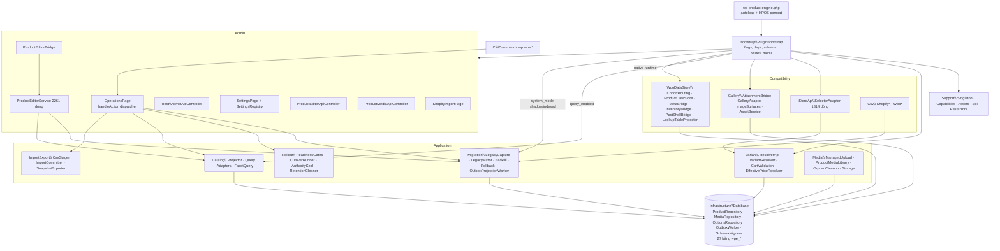

# Báo cáo phân tích & đề xuất refactor — WC Product Engine v1.1.0
Ngày phân tích: 2026-11-20 · Commit gốc: `f9fbad3` (working tree chỉ có `docs/evidence/T16/result.json` bị sửa, không liên quan code)

**Phạm vi đã phân tích sâu:** bootstrap (`wc-product-engine.php`, `src/Bootstrap/PluginBootstrap.php`), lớp `src/Support/*`, toàn bộ REST routes và `permission_callback`, `src/Admin/OperationsPage.php` (dispatcher thao tác vận hành), `src/Admin/Rest/AdminApiController.php` (settings), `src/Application/Catalog/CatalogQuery.php` + `CatalogAdapters.php` (đường truy vấn shop), các phần nóng của `src/Compatibility/StoreApi/SelectorAdapter.php`, `src/Compatibility/Gallery/AttachmentBridge.php`, `src/Application/Variant/ResolverApi.php`, `src/Infrastructure/Database/SchemaMigrator.php`, đường lưu của `ProductEditorBridge` → `ProductEditorService` → `LegacyMirror`.

**Phần mới xem lướt:** `CsvStager`, `ShopifyBatchImporter`, `ShopifyImporter/Exporter`, `WooImporter/Exporter`, `ProductDataStore`, `InventoryBridge`, `MetaBridge`, `CartValidation`, `CutoverRunner`, `RollbackRunner`, `ReadinessGates`, `RetentionCleaner`, `ImageSurfaces`, `ProductMediaApiController` (chỉ phần quyền), JS/CSS (chỉ đo kích thước, `!important`, biến global). Bộ docs/contracts/scripts Node chỉ đọc để lấy bối cảnh.

**Công cụ:** `php -l` pass cho 84/84 file trong `src/` và file chính. Không có `vendor/`, không có `phpcs`/`phpstan` trong dự án hoặc trên PATH, nên **không có baseline PHPCS/PHPStan**. Độ dài hàm được đo bằng script tokenizer chỉ đọc, đặt ngoài repo.

**Bối cảnh từ các audit trước:** repo đã có `docs/audits/P013-architecture-audit.md` (F1–F8) và các commit "Fix F01…F24". Các mục đã sửa (rate limit atomic, F07 không cấp attachment trên page view, F08 bỏ query theo từng card, F12 rebuild chạy nền, F20 ẩn exception, F24 ép kiểu int cho `IN`) **không lặp lại** ở đây. Báo cáo này chỉ nêu những gì còn tồn tại ở HEAD.

---

## 1. Tóm tắt điều hành

### Plugin làm gì (SUY LUẬN, dựa trên code, README và nhãn UI)
Đây là một "engine sản phẩm native" cho WooCommerce. Plugin lưu sản phẩm, biến thể, tồn kho và media vào 27 bảng `wpe_*` riêng, rồi chiếu (mirror) ngược sang `wp_posts`/`postmeta` để WooCommerce và theme vẫn chạy. Việc chuyển quyền sở hữu dữ liệu (authority) từ legacy CPT sang native diễn ra dần theo cohort, có gate, epoch và rollback. Tính năng cốt lõi:
1. **Trình quản lý biến thể / editor sản phẩm** thay tab Variations của Woo (`ProductEditorBridge`, `ProductEditorService`, `assets/admin/product-editor.js`).
2. **Bộ chọn biến thể storefront** gồm swatch/button, Single Price Display và resolver phía server (`SelectorAdapter`, `ResolverApi`, `VariantResolver`, `assets/variant-selector/*`).
3. **Chỉ mục catalog nhanh** thay truy vấn `postmeta` cho trang shop (`CatalogProjector`, `CatalogQuery`, `CatalogAdapters`). Tính năng này nằm sau cờ `query_enabled`.
4. **Import/Export CSV** cho Shopify và Woo, theo lô, có staging (`CsvStager`, `ShopifyBatchImporter`, `SnapshotExporter`).
5. **Vận hành rollout** gồm backfill, shadow diff, gates, cutover, rollback, outbox worker. Có thể chạy qua REST (Settings → Operations) và WP-CLI `wp wpe *`.

### Điểm sức khỏe (1–10)
| Kiến trúc | Logic | DB | Hiệu năng | Bảo mật | Bảo trì | UI |
|---|---|---|---|---|---|---|
| 5 | 6 | 6 | 6 | 5 | 4 | 7 |

Diễn giải: tầng Support (Singleton trait, `Capabilities`, `Assets`, `Sql`, `RestErrors`) và kỷ luật `prepare()` đều tốt. Điểm yếu là rất nhiều god class: 192 hàm dài hơn 50 dòng, 65 hàm dài hơn 100 dòng, `mirrorAggregate` dài 527 dòng. Ngoài ra không có bộ test PHP chạy được trong CI. Lỗi bảo mật nghiêm trọng nhất nằm ở endpoint public `/wpe/v1/catalog` và ở việc phân quyền cho shop manager.

### Top 5 việc nên làm trước nhất
1. **SEC-01**: khóa tham số `status`/`visibility`/`generation` trên endpoint public `/wpe/v1/catalog`. Hiện người dùng ẩn danh đọc được tiêu đề và giá của sản phẩm nháp/riêng tư khi bật `query_enabled`.
2. **SEC-02**: tách quyền vận hành (rollback, mode, outbox, backfill, cờ `native_writes_enabled`) khỏi `manage_woocommerce`. Bạn đã xác nhận shop manager **không** được tin như admin.
3. **LOG-01**: sửa `CatalogAdapters`, vì nó đang âm thầm cắt kết quả `posts_per_page => -1` xuống 48, biến `post_status=any` thành 0 kết quả và bỏ qua `meta_query`. Nếu bật `query_enabled`, theme, plugin khác và sitemap sẽ nhận sai dữ liệu.
4. **DB-01**: sửa cơ chế version schema. `SCHEMA_VERSION` bị kẹt ở `1`, nên mọi bảng hoặc cột thêm sau sẽ không bao giờ được tạo trên site đã cài.
5. **QA-01**: dựng lưới an toàn tối thiểu (PHPUnit/WP test harness chạy trong CI, PHPCS/PHPStan baseline). Phải có lưới này trước mọi refactor god class.

### Kết luận
**Refactor dần là đủ.** Không cần viết lại. Kiến trúc phân lớp (Application / Compatibility / Infrastructure / Admin) có lý do, và các bất biến nghiệp vụ (epoch, revision, outbox) đã được nghĩ kỹ. Cần làm ngay khoảng 5 sửa lỗi nhỏ (bảo mật, đúng đắn). Sau đó tách dần các god class theo kiểu "strangler", có test bao phủ trước khi tách.

---

## 2. Bối cảnh tự khám phá

| Mục | Giá trị | Bằng chứng |
|---|---|---|
| File chính | `wc-product-engine.php` | header `Plugin Name: WC Product Engine` (dòng 3) |
| Version | 1.1.0 (`WPE_VERSION`) | `wc-product-engine.php:6,19` |
| Requires PHP / WP / WC | 8.3 / 7.0 / 11.0 | `wc-product-engine.php:8-10`; kiểm tra lại lúc chạy ở `PluginBootstrap.php:122,132` |
| Text domain | `wc-product-engine` | `wc-product-engine.php:12` |
| Autoload | `spl_autoload_register` PSR-4 tự viết, namespace `WPE\` → `src/`. `composer.json` cũng khai PSR-4 nhưng không có `vendor/` | `wc-product-engine.php:24-38` |
| Readme | `README.md` (docs kit), không có `readme.txt` hay `CHANGELOG` cho plugin (chỉ có `docs/CHANGELOG.md` cho docs) | — |
| Build JS/CSS | Không có. Asset viết tay, cache-bust bằng `filemtime` | `src/Support/Assets.php:78-84` |
| Tích hợp | WooCommerce (data stores, Store API, blocks, HPOS compat), WP-CLI (15 lệnh `wpe *`), Media Library, Gutenberg block filter `render_block_woocommerce/product-image`. **Không** dùng ACF, Elementor, Action Scheduler hay WP-Cron (worker chạy bằng system cron qua WP-CLI) | `PluginBootstrap.php:592-631`, `Cli/Commands.php:32-44`, `wc-product-engine.php:43-48` |
| Multisite | Không có xử lý riêng (`registerCapabilities` chỉ chạy cho site hiện tại) — CẦN XÁC MINH nếu có kế hoạch multisite | `PluginBootstrap.php:336-346` |
| Test | 77 file trong `tests/integration` (script PHP tự chạy, **không phải PHPUnit**), 1 file unit, 13 E2E Playwright, benchmark. Test hardcode `/var/www/site1.localhost/wp-load.php` (49 chỗ) | `tests/integration/T10Test.php:15-22` |
| CI | `.github/workflows/docs.yml` chỉ chạy `check-docs`, `plan.mjs check`, `guard.mjs`. **Không chạy test PHP, không lint PHP** | `.github/workflows/docs.yml` |
| Lịch sử | 167 commit, theo kế hoạch P001–P027 và audit F01–F24 | `git log` |

**Hotspot (số commit chạm vào file, chỉ tính `src/`, `assets/`):**
`product-editor.css` 16 · `PluginBootstrap.php` 15 · `ProductEditorService.php` 15 · `ShopifyBatchImporter.php` 14 · `product-editor.js` 14 · `ProductEditorBridge.php` 12 · `LegacyMirror.php` 11 · `AdminApiController.php` 9 · `OperationsPage.php` 9.
→ Các hotspot trùng với god class lớn nhất. Đây là nơi refactor mang lại nhiều lợi nhất và cũng rủi ro nhất.

**Kích thước:** 84 file PHP, 45.851 dòng. Top: `ProductEditorService` 2261, `SelectorAdapter` 1814, `ShopifyBatchImporter` 1554, `CsvStager` 1301, `ProductDataStore` 1221, `VariantResolver` 1162. JS: `product-editor.js` 6023 dòng một file.

---

## 3. Bản đồ hệ thống

### 3.1 Sơ đồ module



Phụ thuộc đáng chú ý: `CatalogAdapters` gọi phương thức **private** của `CatalogQuery` bằng Reflection (`CatalogAdapters.php:410-421`). `OperationsPage` vừa là controller REST vừa là dispatcher cho CLI (`Cli/Commands.php:156`).

### 3.2 Điểm vào

**Bootstrap** (`PluginBootstrap.php`):
- `plugins_loaded` @20 → `onPluginsLoaded` (`:59`). Mỗi request đều chạy `ensureSchema`, `registerCapabilities`, `getSystemMode()` (1 query SQL) rồi đăng ký mọi module (`:77-114`).
- `admin_menu` @1 (redirect) và @10 (menu), `admin_enqueue_scripts` (`:83-85`); `woocommerce_data_stores` (`:385`); `rest_api_init` closure (`:513`).
- `before_woocommerce_init` (khai báo HPOS/blocks, `wc-product-engine.php:43`).
- Activation/deactivation (`:546-547`). **Không có `uninstall.php`.**

**REST (namespace `wpe/v1`)**:
| Route | Method | Quyền | File |
|---|---|---|---|
| `/catalog` | GET | `__return_true` (**public**) | `CatalogQuery.php:628-632` |
| `/products/{id}/resolve` | POST | `__return_true` (public, có rate limit) | `ResolverApi.php:90-93` |
| `/status`, `/operations/health`, `/operations/action` | GET/POST | `canManageOperations` = `wpe_manage_operations` **hoặc `manage_woocommerce`** | `PluginBootstrap.php:514`, `OperationsPage.php:126-136` |
| `/admin/settings` GET/POST, `/admin/rebuild-index` | — | `manage_woocommerce` | `AdminApiController.php:46-64,122-125` |
| `/admin/shopify-import/*` (9 route) | — | `wpe_import_products` hoặc `manage_woocommerce`; `validate-server-file` cần `manage_options` | `AdminApiController.php:67-135` |
| `/admin/imports`, `/admin/imports/{job}/commit`, `/admin/jobs/{id}` | — | `manage_woocommerce`/`wpe_import_products`/`wpe_manage_operations` | `CsvStager.php:1016-1042` |
| `/admin/exports`, `/admin/jobs/{id}/download`, `/cancel` | — | `checkDownloadPermissions` | `SnapshotExporter.php:608-625` |
| `/product/{id}/variants*` (7 route) | — | `manage_woocommerce` hoặc `edit_post` | `ProductEditorApiController.php:40-142` |
| `/admin/assets`, `/admin/products/{id}/media*`, `/admin/upload-sessions/*`, `/admin/assets/{id}/file` | — | `upload_files` + `edit_post`/`edit_products` | `ProductMediaApiController.php:75-150` |

**wc-ajax:** `wc_ajax_get_variation` @5 (`ResolverApi.php:79`). **Không có** `wp_ajax_*`, shortcode, block riêng hay cron event.
**WP-CLI:** `wpe status|flag` (`PluginBootstrap.php:596-630`), `wpe health|migrate|rebuild|audit|rollback|export|media|lookup|mode|outbox|gates|cutover|hygiene` (`Cli/Commands.php:32-44`).
**Hook frontend nặng:** `posts_pre_query` (`CatalogAdapters.php:55`, khi bật `query_enabled`); 7 filter attachment/ảnh toàn site (`AttachmentBridge.php:82-112`, **luôn bật**); 8 hook storefront của `SelectorAdapter` (`:116-138`); `get/update/add/delete_post_metadata` (`MetaBridge.php:111-114`, chỉ khi native runtime).

### 3.3 Public API surface (thứ bên ngoài có thể phụ thuộc)
- **Hook do plugin phát ra:** `wpe_catalog_generations_to_keep`, `wpe_catalog_sync_rebuild_max_products`, `wpe_project_product_meta_lookup`, `wpe_allow_attachment_allocation`, `wpe_handle_wc_ajax_get_variation`, `wpe_resolver_rate_limit`, `wpe_resolver_client_ip`, `wpe_import_server_path_roots`, `wpe_media_library_replaces_native_boxes`, `wpe_editor_mode` (filter); `wpe_product_media_changed` (action). Plugin cũng phát lại hook core Woo trong `ProductLifecycle.php:136-153` và `ResolverApi.php:384`.
- **Hằng/global:** `WPE_VERSION`, `WPE_PLUGIN_FILE`, `WPE_PLUGIN_DIR`, `WPE_TRUSTED_PROXY_HEADER` (hằng cấu hình tùy chọn).
- **Class public:** toàn bộ `WPE\*`, vì không class nào `final`/`@internal` trừ Support. Các class được gọi trực tiếp từ test và CLI.
- **Options:** `wpe_feature_flags`, `wpe_cohort_routing`, `wpe_attribute_display_config`, `wpe_product_page_settings_ver`, `wpe_schema_version`, `wpe_migration_checkpoint`, `wpe_selector_cache_ver` (autoload=no), `wpe_editor_mode` cùng các option trong `OptionsRepository`/`SettingsPage`.
- **Capability:** `wpe_import_products`, `wpe_export_products`, `wpe_manage_operations` (`Support/Capabilities.php:34-43`).
- **Meta key:** `_wpe_asset_id` trên attachment (`AttachmentBridge.php:332`).
- **Bảng:** 27 bảng `{prefix}wpe_*` (`contracts/database/schema.sql`); bảng `wpe_control` chứa `system_mode`, `catalog_rebuild_requested`, `shadow_diff_mismatches`.
- **Transient:** `wpe_migration_lock`, `wpe_save_op_*`, `wpe_rl_*` (rate limit), failure/draft của editor.
- **JS global:** `wpeImportConfig`, `wpeAdminConfig`, `wpeOpsConfig` cùng config localize của editor và selector. CSS prefix `wpe-`.

### 3.4 Luồng end-to-end các tính năng cốt lõi

**(1) Lưu sản phẩm bằng editor biến thể**
1. Woo submit `post.php`, xác thực nonce `woocommerce_meta_nonce`, rồi chạy `woocommerce_process_product_meta` @1 `guardLegacyProductKeys` và @20 `processProductMetaSave` (`ProductEditorBridge.php:161-162`).
2. Kiểm nonce `wpe_save_variants` và quyền (`ProductEditorBridge.php:614-622`), sau đó `json_decode` payload (`:624`).
3. `ProductEditorService::saveProductVariants` (`ProductEditorService.php:894`, dài 331 dòng): mở `START TRANSACTION`, đồng bộ option/biến thể/giá/tồn, `COMMIT` (`:1134`).
4. Sau commit: ghi `wpe_object_state` với `authority='native'` (`:1155-1165`) → `LegacyMirror::mirrorAggregate` (`:1166`) ghi `wp_posts`/`postmeta`/lookup → đánh dấu outbox `completed` (`:1168-1172`) → refresh catalog.
5. Kết quả: transient cảnh báo nếu projection lỗi (`ProductEditorBridge.php:645-656`).

**(2) Storefront: trang sản phẩm biến thể**
`wp_enqueue_scripts` → `SelectorAdapter::enqueueScripts` (`:279`) → `woocommerce_ajax_variation_threshold` = 0 (`:283-298`) → `renderSwatchControls`/`renderFormInstanceConfig` → `getSelectorConfig` (`:536`), lấy object cache theo khóa chữ ký sinh bởi một query SQL tổng hợp (`:1697-1720`) → client gọi `POST /wpe/v1/products/{id}/resolve` (`ResolverApi.php:106`): rate limit (`:111`) → đọc `wpe_products` (`:124`) → `VariantResolver::resolve` (`:192`).

**(3) Trang shop qua chỉ mục catalog (`query_enabled`)**
`WP_Query` → `posts_pre_query` (`CatalogAdapters.php:455`) → `evaluateQuerySupport` (`:68`) → `adaptWcQueryArgs` (`:210`) → `executeAdaptedQuery` (`:383`) gọi Reflection vào `CatalogQuery::compileQuery`/`executeCount` → SQL trên `wpe_catalog` (+ JOIN `wpe_catalog_facets`) → `_prime_post_caches` → trả `WP_Post[]` (`:525-528`).

**(4) Import Shopify CSV**
Upload qua `POST /admin/shopify-import/upload` → `init` → client lặp `process-batch` (`AdminApiController.php:67-90`) → `ShopifyBatchImporter::runLockedBatch` (`:388`, dài 383 dòng) → ghi repo native → `LegacyMirror::mirrorAggregate` (`ShopifyBatchImporter.php:1054`).

**(5) Vận hành rollout**
UI Settings → Operations hoặc `wp wpe <cmd>` → `OperationsPage::handleAction` (`:307`) → switch qua `migrate|rebuild|audit|rollback|mode|outbox|gates|cutover|hygiene|export|resume_job` (`:325-528`) → ghi audit (`:316,532`) → `sanitizeOutput` (`:545`).

---

## 4. Bảng phát hiện

Thang: Tác động 1–5 · Công sức S/M/L · Rủi ro khi sửa T(thấp)/TB/C(cao).

| ID | Nhóm | Mức độ | File:dòng | Vấn đề | Tác động | Công sức | Rủi ro sửa | Ưu tiên |
|---|---|---|---|---|---|---|---|---|
| SEC-01 | E | 🔴 | `Application/Catalog/CatalogQuery.php:249-250,313-325,156,628-632` | Endpoint public `/catalog` nhận `status`, `visibility`, `generation` từ người dùng ẩn danh; chỉ mục chứa cả sản phẩm draft/private/pending (`CatalogProjector.php:234,617`) → lộ tiêu đề, giá, tồn kho của sản phẩm chưa xuất bản | 5 | S | T | Làm ngay |
| SEC-02 | E | 🟠 | `Support/Capabilities.php:48-51`; `Admin/OperationsPage.php:310,388-447`; `Admin/Rest/AdminApiController.php:122-125` | Shop manager (`manage_woocommerce`) được chạy rollback, đổi `system_mode`, drain outbox, backfill, và bật/tắt `native_writes_enabled` (master gate) | 5 | S | TB | Làm ngay |
| PERF-01 | D/E | 🟠 | `CatalogQuery.php:382-396,351-358,226-229` | Endpoint public không giới hạn số `attributes`/`category`/`tag` (mỗi attribute thêm 1 JOIN), cho phép `search` LIKE `%x%` + subquery `LOWER(CAST…)` và `count_mode=exact`, không có rate limit → bề mặt DoS DB | 4 | S | T | Làm ngay |
| LOG-01 | B | 🟠 | `Application/Catalog/CatalogAdapters.php:100,270-275,349-354,399,72-80,344-345` | `posts_pre_query` chặn **mọi** WP_Query `product` (không riêng main query): `posts_per_page=-1` → 48, tối đa 100; `post_status='any'` → lọc `status='any'` → 0 kết quả; `meta_query` được "hỗ trợ" nhưng bị bỏ qua khi adapt; orderby lạ → sắp theo giá | 5 | M | TB | Làm ngay (trước khi bật `query_enabled` ở prod) |
| DB-01 | C/F | 🟠 | `Infrastructure/Database/SchemaMigrator.php:7`; `Bootstrap/PluginBootstrap.php:573-584`; `UploadItemRepository.php:46-66` | `SCHEMA_VERSION=1` chưa từng tăng dù P011 đã thêm bảng; `ensureSchema` return sớm nên site cũ không có bảng mới; đang vá bằng `SHOW TABLES` mỗi lần gọi; không có ALTER/migration cột | 4 | M | TB | Kế hoạch (sớm) |
| LOG-02 | B | 🟠 (CẦN XÁC MINH) | `Application/Migration/LegacyMirror.php:83-112,574-590`; `Admin/ProductEditor/ProductEditorService.php:1155-1172` | Kiểm tra epoch/revision không có khóa (TOCTOU); `native_applied = VALUES(...)` không đơn điệu; editor ghi `native_revision = %d` (không `GREATEST`), mirror trực tiếp ngoài lease outbox → editor và worker chạy song song có thể ghi đè legacy bằng revision cũ | 4 | M | C | Kế hoạch |
| SEC-03 | E | 🟡 | `ResolverApi.php:536-546` | Lấy IP **trái nhất** của header proxy (XFF) — client tự gửi được → vượt rate limit nếu `WPE_TRUSTED_PROXY_HEADER=HTTP_X_FORWARDED_FOR` | 3 | S | T | Quick win |
| LOG-03 | B | 🟡 (CẦN XÁC MINH) | `Compatibility/StoreApi/SelectorAdapter.php:255` vs `Bootstrap/PluginBootstrap.php:23`, `SettingsRegistry.php:42` | Storefront đọc cờ `variant_selector_ui`, nhưng không nơi nào ghi cờ này (Settings ghi `variants_ui_enabled`) → UI selector storefront luôn bật mặc định, không tắt được từ Settings | 3 | S | TB | Quick win |
| LOG-04 | B | 🟡 | `OperationsPage.php:390-397` | Rollback không truyền cohort thì chọn `LIMIT 500` sản phẩm native mà không báo còn sót → với >20k sản phẩm, rollback một phần nhưng trông như xong | 4 | S | TB | Quick win |
| LOG-05 | B | 🟡 | `OperationsPage.php:511-525` | `resume_job` đặt `status='running'` cho **bất kỳ** job id, không kiểm tra trạng thái hay sự tồn tại | 2 | S | T | Quick win |
| PERF-02 | D | 🟡 | `OperationsPage.php:326-335,444-447`; `PluginBootstrap.php:513-526` | REST chạy đồng bộ `outbox` (tối đa `batch_size×max_batches` do client gửi, không chặn trên) và `backfill` với `batch_size` tự do; mọi request REST (kể cả Store API public) đều khởi tạo `OperationsPage` cùng `LegacyCapture/LegacyMirror/RollbackRunner` | 3 | S | T | Quick win |
| PERF-03 | D/C | 🟡 | `PluginBootstrap.php:102,357-380`; `:77-78,336-346` | Mỗi request chạy 1 query `wpe_control` (`getSystemMode`) không qua cache, cộng `get_role`/`has_cap` | 2 | S | T | Quick win |
| PERF-04 | D/C | 🟡 | `Compatibility/Gallery/AttachmentBridge.php:82-112,332-349` | 7 filter ảnh đăng ký toàn site bất kể `media_enabled`; mỗi attachment không thuộc engine tốn 1 `SELECT … wpe_assets WHERE attachment_id` mỗi request, không có object cache | 3 | S | T | Quick win |
| PERF-05 | D/C | 🟡 | `SelectorAdapter.php:1659-1690,1697-1720` | Khóa cache "giá thấp nhất" được tính bằng 1 query `GROUP_CONCAT` trên toàn bộ biến thể và tồn kho, **mỗi card** khi bật Single Price Display; độ dài `GROUP_CONCAT` phụ thuộc `group_concat_max_len` (MySQL mặc định 1024 → chữ ký bị cắt → cache cũ) — CẦN XÁC MINH cấu hình DB prod | 3 | M | TB | Kế hoạch |
| PERF-06 | D | 🟡 | `Application/Catalog/CatalogProjector.php:181-193` | `refreshProduct` gọi `buildNewGeneration()` (rebuild toàn bộ) **trong request lưu** khi generation đang rỗng → với >20k sản phẩm lại rơi vào kịch bản F12 | 3 | S | T | Quick win |
| ARCH-01 | A | 🟡 | `CatalogAdapters.php:410-421` | Dùng Reflection gọi method private `compileQuery/executeCount/normalizeFilters` của `CatalogQuery`, sau đó sửa SQL bằng `preg_replace('/LIMIT\s+%d$/'…)` (`:424-426`) | 3 | S | T | Kế hoạch |
| ARCH-02 | A/F | 🟠 | `ProductEditorService.php` (2261), `SelectorAdapter.php` (1814), `ShopifyBatchImporter.php` (1554), `CsvStager.php` (1301), `LegacyMirror::mirrorAggregate` (527 dòng, `:80`) | God class/hàm khổng lồ: 192 hàm >50 dòng, 65 hàm >100 dòng; trùng với hotspot commit | 4 | L | C | Kế hoạch (sau QA-01) |
| ARCH-03 | A | 🔵 | `OperationsPage.php:307-540` | Dispatcher `switch` 233 dòng, trộn controller REST, use-case và SQL trực tiếp (`:372-377,427-432`) | 3 | M | TB | Kế hoạch |
| ARCH-04 | A | 🔵 | `ResolverApi.php:28,57-63`, `SelectorAdapter.php:95-101`, `AttachmentBridge.php:58-64`, `PluginBootstrap.php:11,38-44` | Vẫn còn singleton tự viết song song với trait `Support\Singleton`; `SelectorAdapter::register` ghi đè `self::$instance` (`:109`) | 2 | S | T | Cân nhắc sau |
| ARCH-05 | A | 🔵 | `OperationsPage.php:171-184` vs `PluginBootstrap.php:357-380` | Logic giải mã `system_mode` bị lặp ở 2 nơi | 2 | S | T | Quick win |
| QA-01 | F | 🟠 | `.github/workflows/docs.yml`; `tests/integration/*.php:15-22` | Không có PHPUnit, PHPCS hay PHPStan; CI không chạy test PHP; test hardcode đường dẫn `site1` và chạy trên DB live | 5 | M | T | Làm ngay (Giai đoạn 0) |
| F-01 | F | 🔵 | 84/84 file `src/*.php` | Thiếu `defined('ABSPATH') \|\| exit;` (file chỉ khai báo class nên rủi ro thấp, nhưng Plugin Check/WPCS sẽ cảnh báo) | 1 | S | T | Cân nhắc sau |
| F-02 | F | 🔵 | 21 file thiếu `declare(strict_types=1)` (vd. `PluginBootstrap.php`, `SchemaMigrator.php`, `ResolverApi.php`) | Không nhất quán; audit P013 đã chủ động không thêm | 1 | S | TB | Cân nhắc sau |
| F-03 | F | 🔵 | không có `uninstall.php`; `PluginBootstrap.php:548` | Gỡ plugin để lại 27 bảng, options, capabilities. Có thể là cố ý (R06) nhưng không có tùy chọn "xóa dữ liệu khi gỡ" | 2 | S | TB | Cân nhắc sau |
| F-04 | F | 🔵 | `ResolverApi.php:121,135,144`; `PluginBootstrap.php:124,131,612-623` | Chuỗi trả cho người dùng không qua `__()` | 2 | S | T | Cân nhắc sau |
| SEC-04 | E | 🔵 | `CatalogQuery.php:44` | Khóa HMAC cursor dùng thẳng `AUTH_SALT` với fallback hằng chuỗi công khai `'wpe_catalog_default_hmac_secret_2026'`; nên dùng `wp_salt()` | 2 | S | T | Quick win |
| SEC-05 | E | 🔵 | `ProductEditorBridge.php:619`; `ProductEditorApiController.php:137-141` | Kiểm quyền `edit_post(id) \|\| manage_woocommerce`: OR bỏ qua quyền theo từng bài; thông báo lỗi lấy thẳng `$e->getMessage()` (`ProductEditorBridge.php:634`) có thể lộ lỗi SQL trong admin notice | 2 | S | T | Quick win |
| LOG-06 | B | 🔵 | `AdminApiController.php:188-196`; `PluginBootstrap.php:192-197` | Lưu flags theo kiểu read-modify-write toàn option → 2 admin lưu cùng lúc sẽ mất thay đổi | 1 | S | T | Cân nhắc sau |
| LOG-07 | B | 🔵 | `PluginBootstrap.php:314-333`, `:35` vs `:354` | `resolveProductAuthority` trả giá trị routing không validate; comment `cohort_mode` liệt kê 3 giá trị nhưng runtime chấp nhận thêm `native_bridge` | 2 | S | T | Cân nhắc sau |
| LOG-08 | B | 🔵 | `CatalogQuery.php:124-126` | Kiểm tra generation của cursor là nhánh rỗng (no-op) | 1 | S | T | Cân nhắc sau |
| LOG-09 | B | 🟠 | `Compatibility/WooDataStore/ProductDataStore.php:183,1101` (trước sửa) | Data store native: `get_price()` sản phẩm biến thể = '' (67/67 trên site1); `price` = `sale_price` bất kể lịch sale/giá sale > giá gốc; không đọc/ghi `date_on_sale_from/to`; repository không xóa được lịch sale. Trái `contracts/compatibility/wc-props-mapping.json` | 4 | M | TB | Đã sửa (`fdc20b9`) |
| UI-01 | G/F | 🟡 | `assets/admin/product-editor.js` (6023 dòng), `product-editor.css` (3139 dòng) | Một file JS khổng lồ, không module hay build và là hotspot #1–#5; `!important` còn 22 chỗ (`selector.css` 11, `product-editor.css` 8, `settings.css` 3) | 3 | L | TB | Cân nhắc sau |

---

## 5. Chi tiết & phương án (các mục 🔴/🟠)

### SEC-01 🔴 — `/wpe/v1/catalog` public lộ sản phẩm chưa xuất bản

**Code hiện tại**
```php
// CatalogQuery.php:628-632
register_rest_route('wpe/v1', '/catalog', [
    'methods'             => 'GET',
    'callback'            => [self::class, 'handleRestRequest'],
    'permission_callback' => '__return_true',
]);
// CatalogQuery.php:156
$gen = isset($args['generation']) ? (int)$args['generation'] : $this->projector->getActiveGeneration();
// CatalogQuery.php:249-250
if (isset($args['status'])) $f['status'] = (string)$args['status'];
if (isset($args['visibility'])) $f['visibility'] = (string)$args['visibility'];
// CatalogQuery.php:313-318
if (isset($filters['status'])) { $where[] = "c.status = %s"; $params[] = $filters['status']; }
else { $where[] = "c.status = 'publish'"; }
```
Chỉ mục có chứa sản phẩm chưa publish: `CatalogProjector.php:617` `WHERE deleted_at IS NULL AND status != 'trash'`, và `:283` lưu nguyên `$prod['status']`.

**Vấn đề:** khi `query_enabled=true`, người dùng ẩn danh gửi `GET /wp-json/wpe/v1/catalog?status=draft` (hoặc `private`, `pending`, `future`) hay `?visibility=hidden` sẽ nhận `title`, `min_price`, `max_price`, `in_stock`, `total_sales`, `image_asset_id` của sản phẩm chưa ra mắt. Tham số `generation` còn cho đọc các generation cũ đang giữ lại (`generationsToKeep()`).

**Đề xuất diff**
```diff
--- a/src/Application/Catalog/CatalogQuery.php
+++ b/src/Application/Catalog/CatalogQuery.php
@@ public static function handleRestRequest(\WP_REST_Request $request): \WP_REST_Response
-        $params = $request->get_params();
+        $params = $request->get_params();
+        // Public callers only ever see the published, catalog-visible, active generation.
+        // Editors keep the extended filters (status/visibility/generation) for admin tooling.
+        if (!current_user_can('edit_products')) {
+            unset($params['status'], $params['generation']);
+            if (isset($params['visibility']) && !in_array($params['visibility'], ['visible', 'catalog', 'search'], true)) {
+                unset($params['visibility']);
+            }
+        }
```
Lớp phòng thủ thứ hai, đặt trong `compileQuery`/`executeCount` (`:313`, `:543`): chỉ nhận `status` thuộc whitelist `['publish','draft','pending','private','future']`.

**Tương thích:** route, tham số và response không đổi đối với người đăng nhập có quyền. Client public nào đang (sai) dựa vào `status=draft` sẽ chỉ nhận sản phẩm publish. CẦN XÁC MINH: hiện có frontend hoặc tích hợp nào gọi `/wpe/v1/catalog`? Kiểm tra bằng `rg -n "wpe/v1/catalog" assets/ docs/ tests/` và log truy cập nginx.

**Kiểm chứng:** thêm test `tests/integration/CatalogPublicVisibilityTest.php`: seed 1 sản phẩm draft, gọi `rest_do_request(new WP_REST_Request('GET','/wpe/v1/catalog'))` với `status=draft` khi `wp_set_current_user(0)` và kỳ vọng ID draft không có trong `items`. Với user admin thì kỳ vọng có. Kiểm tra thủ công: `curl 'https://site/wp-json/wpe/v1/catalog?status=draft'` không còn trả item draft.

---

### SEC-02 🟠 — Shop manager chạy được thao tác rollout/authority

**Code hiện tại**
```php
// Support/Capabilities.php:48-51
public static function canManageOperations(): bool
{
    return current_user_can(self::MANAGE_OPERATIONS) || current_user_can('manage_woocommerce');
}
// OperationsPage.php:310 (kiểm tra thứ hai, cùng logic)
if ($actorId > 0 && !user_can($actorId, 'wpe_manage_operations') && !user_can($actorId, 'manage_woocommerce')) {
// AdminApiController.php:122-125 — lưu được cả 'native_writes_enabled' (RUNTIME_GATE)
public function checkSettingsPermission(): bool { return current_user_can('manage_woocommerce'); }
```
**Vấn đề:** role `shop_manager` mặc định có `manage_woocommerce`, nên được `rollback` tối đa 500 sản phẩm (`:388-404`), đổi `system_mode` legacy/shadow/indexed và ghi `query_enabled` (`:406-438`), drain outbox đồng bộ (`:440-447`), và bật cờ master `native_writes_enabled` qua Settings. Cutover thì không chạy được qua web vì web actor không nhận `gate_receipt_token` (`:476`). Bạn đã chốt "shop manager KHÔNG được tin như admin".

**Phương án**
| | A. Cap riêng, admin-only (khuyến nghị) | B. Tách 2 tầng đọc/ghi | C. Giữ nguyên, thêm filter |
|---|---|---|---|
| Mô tả | Thao tác ghi/rollout yêu cầu `wpe_manage_operations` (chỉ admin được cấp); health/status vẫn đọc được bằng `manage_woocommerce` | `canViewOperations()` (đọc) và `canRunOperations()` (ghi); cờ `RUNTIME_GATE` trong Settings cần `manage_options` | `apply_filters('wpe_can_manage_operations', …)` |
| Công sức | S | S–M | S |
| Rủi ro | Shop manager mất nút thao tác (đúng ý) | Cần sửa UI ẩn nút theo quyền (`canManageOps` đã có, `PluginBootstrap.php:487`) | Mặc định vẫn không an toàn |
| BC | Cap đã tồn tại, admin được cấp sẵn (`registerCapabilities`) | Như A | Giữ nguyên hoàn toàn |

**Khuyến nghị B**: nó giữ trang health cho shop manager và đóng mọi đường ghi.

```diff
--- a/src/Support/Capabilities.php
+++ b/src/Support/Capabilities.php
-    public static function canManageOperations(): bool
-    {
-        return current_user_can(self::MANAGE_OPERATIONS) || current_user_can('manage_woocommerce');
-    }
+    /** Read-only operations views (health, status). */
+    public static function canViewOperations(): bool
+    {
+        return current_user_can(self::MANAGE_OPERATIONS) || current_user_can('manage_woocommerce');
+    }
+
+    /** Mutating rollout actions: dedicated capability only (administrators by default). */
+    public static function canRunOperations(): bool
+    {
+        return current_user_can(self::MANAGE_OPERATIONS);
+    }
+
+    /** @deprecated 1.2.0 Use canViewOperations() or canRunOperations(). */
+    public static function canManageOperations(): bool
+    {
+        _deprecated_function(__METHOD__, '1.2.0', __CLASS__ . '::canViewOperations');
+        return self::canViewOperations();
+    }
```
```diff
--- a/src/Admin/OperationsPage.php
@@ registerRestRoutes
-            'permission_callback' => [$this, 'checkPermission'],   // /operations/action
+            'permission_callback' => [Capabilities::class, 'canRunOperations'],
@@ handleAction
-        if ($actorId > 0 && !user_can($actorId, 'wpe_manage_operations') && !user_can($actorId, 'manage_woocommerce')) {
+        if ($actorId > 0 && !user_can($actorId, Capabilities::MANAGE_OPERATIONS)) {
```
Trong `AdminApiController::saveSettings`: nếu payload có khóa thuộc `runtime === RUNTIME_GATE` và nhóm Features (`native_writes_enabled`, `variants_ui_enabled`) thì yêu cầu `manage_options`, ngược lại trả 403 `forbidden`.

**Kiểm chứng:** tạo user role `shop_manager` và gọi `POST /wpe/v1/operations/action {action:"rollback"}` → kỳ vọng 403. Với admin → 200. `GET /operations/health` bằng shop manager → 200. Chạy lại `tests/integration/SettingsApiTest.php` và các test T41.

---

### PERF-01 🟠 — Endpoint public không giới hạn độ phức tạp truy vấn

**Code hiện tại**
```php
// CatalogQuery.php:382-396 — mỗi attribute = 1 INNER JOIN, không giới hạn số lượng
foreach ($filters['attributes'] as $attrKey => $attrVals) {
    $idx++;
    $alias = "f_attr_{$idx}";
    $joins[] = "INNER JOIN {$this->tableCatalogFacets} {$alias} ON (...)";
// CatalogQuery.php:355 — LIKE hai đầu + subquery LOWER(CAST(...)) không dùng được index
$where[] = "(c.title_sort LIKE %s OR c.product_id IN (SELECT object_id FROM ...wpe_sku_registry WHERE original_sku LIKE %s OR LOWER(CAST(normalized_sku AS CHAR)) LIKE %s))";
```
**Vấn đề:** với `?attributes[a1]=x&…&attributes[a60]=x&count_mode=exact&search=a`, request ẩn danh sinh ra 60 JOIN cộng 2 lần full scan (SELECT + COUNT), và không có rate limit (khác `/resolve`). Có thể dùng để làm quá tải DB.

**Đề xuất:**
```diff
+    private const MAX_FACET_GROUPS = 8;
+    private const MAX_FACET_VALUES = 20;
+    private const MAX_SEARCH_LEN   = 100;
@@ normalizeFilters
-        if (isset($args['attributes']) && is_array($args['attributes'])) $f['attributes'] = $args['attributes'];
+        if (isset($args['attributes']) && is_array($args['attributes'])) {
+            if (count($args['attributes']) > self::MAX_FACET_GROUPS) {
+                throw new InvalidArgumentException('Too many attribute filters.');
+            }
+            $f['attributes'] = array_map(
+                static fn($v) => array_slice(is_array($v) ? $v : [(string)$v], 0, self::MAX_FACET_VALUES),
+                $args['attributes']
+            );
+        }
+        // same slice for category / tag; mb_substr(search, 0, MAX_SEARCH_LEN)
```
Thêm: chỉ cho `count_mode=exact` khi `current_user_can('edit_products')`, và dùng lại `ResolverApi::checkRateLimit` (tách ra `Support\RateLimiter`, xem §6) cho `/catalog`.

**Kiểm chứng:** test gửi 9 nhóm attribute → 400 `invalid_request`. Benchmark `tests/performance/ScaleBenchmark.mjs` không đổi với truy vấn hợp lệ.

---

### LOG-01 🟠 — `CatalogAdapters` trả kết quả sai cho các WP_Query không phải archive

**Code hiện tại**
```php
// CatalogAdapters.php:458-465 — mọi query post_type=product đều bị chặn, không riêng main/wc_query
if (!$isSingleProductType && !$query->get('wc_query')) { return null; }
// :100 — 'any' được coi là hỗ trợ
$allowedStatuses = ['publish', 'draft', 'trash', 'any'];
// :270-275 — chỉ lấy status đầu tiên, 'any' thành điều kiện c.status = 'any'
$adapted['status'] = is_array($queryVars['post_status']) ? reset($queryVars['post_status']) : (string)$queryVars['post_status'];
// :354 — posts_per_page = -1 → 48
$adapted['limit'] = $limit !== null && $limit > 0 ? $limit : self::DEFAULT_PER_PAGE;
// :399 — trần 100
$limit = min($adapted['limit'] ?? self::DEFAULT_PER_PAGE, 100);
// :72-80 kiểm meta_query (chỉ cấp 1) nhưng adaptWcQueryArgs không dịch meta_query → filter bị bỏ âm thầm
// :344-345 default → 'price_asc' (rand, relevance, post__in, meta_value… đều thành sắp theo giá)
```
**Vấn đề (khi `query_enabled`):** `get_posts(['post_type'=>'product','numberposts'=>-1])` của theme hoặc plugin khác chỉ nhận 48 sản phẩm. WP core sitemaps (`wp-sitemap-posts-product-N.xml`, 2000/trang) chỉ còn 100 URL. WC REST `/wc/v3/products?status=any` (request REST không phải `is_admin`) trả rỗng. `meta_query` theo `_price`/`_stock_status` bị bỏ qua, trái R78 "không âm thầm bỏ filter". Ở `full_native`, những trường hợp không hỗ trợ sẽ **throw** từ `posts_pre_query` và gây 500.

**Phương án**
| | A. Chỉ chặn main query + `wc_query` (khuyến nghị) | B. Giữ phạm vi, vá từng tham số | C. Opt-in bằng query var `wpe_catalog => true` |
|---|---|---|---|
| Công sức | S | M | S |
| Lợi | Thu hẹp bề mặt ngay; query phụ trả về core (đúng) | Tăng lợi ích hiệu năng cho widget và block | An toàn tuyệt đối |
| Rủi ro | Mất tăng tốc cho block Product Collection (cần bật riêng qua `adaptBlockQuery`) | Dễ sót tham số (author, date_query, lang, post_parent…) | Gần như không ai được tăng tốc |

**Khuyến nghị A cộng các vá tối thiểu của B:**
```diff
@@ handlePostsPreQuery
-        if (!$isSingleProductType && !$query->get('wc_query')) {
-            return null;
-        }
+        // Only the storefront product archive is served from the index; secondary queries
+        // (widgets, sitemaps, other plugins, WC REST) keep core semantics (R76, AC-T19-02).
+        if (!$query->get('wc_query') && !$query->is_main_query()) {
+            return null;
+        }
+        if ((int)$query->get('posts_per_page') === -1 || $query->get('nopaging')) {
+            return null;
+        }
@@ evaluateQuerySupport
-            $allowedStatuses = ['publish', 'draft', 'trash', 'any'];
+            $allowedStatuses = ['publish'];
+        // meta_query is not translated by adaptWcQueryArgs(): treat any non-empty meta_query as unsupported
+        if (!empty($queryVars['meta_query'])) {
+            $unsupported[] = 'meta_query is not served by the catalog index';
+        }
+        foreach (['author', 'author__in', 'date_query', 'post_parent', 'post_parent__in', 'name__in'] as $k) {
+            if (!empty($queryVars[$k])) { $unsupported[] = "Unsupported {$k}"; }
+        }
@@ adaptWcQueryArgs default orderby
-            default:
-                $adapted['sort'] = 'price_asc';
+            default: // rand, relevance, post__in, meta_value… → let core answer
+                throw new UnsupportedQueryException("Unsupported orderby '{$orderby}'");
```
(Ở chế độ không strict, `handlePostsPreQuery` bắt exception và `return null`.)

**Kiểm chứng:** test tích hợp với `query_enabled=true`:
(1) `get_posts(['post_type'=>'product','posts_per_page'=>-1])` trả số lượng bằng `wp_count_posts('product')->publish`;
(2) `new WP_Query(['post_type'=>'product','post_status'=>'any'])` không rỗng;
(3) trang `/shop/` vẫn đi qua engine (đo bằng `$wpdb->queries` chứa `wpe_catalog`);
(4) `/wp-sitemap-posts-product-1.xml` đủ URL. Chạy lại toàn bộ T19.

---

### DB-01 🟠 — Version schema bị kẹt, không migrate được site đã cài

**Code hiện tại**
```php
// SchemaMigrator.php:7
public const SCHEMA_VERSION = 1;          // không đổi từ c6e26a3 (T05), dù 656be86 (P011) thêm bảng
// PluginBootstrap.php:575-578
$installed = (int) get_option(SchemaMigrator::OPTION_SCHEMA_VERSION, 0);
if ($installed >= SchemaMigrator::SCHEMA_VERSION) { return; }
// UploadItemRepository.php:52-65 — workaround: SHOW TABLES mỗi lần gọi
```
**Vấn đề:** site cài trước P011 có `wpe_schema_version=1`, nên `ensureSchema()` không bao giờ tạo `wpe_asset_storage`/`wpe_upload_items`. Hiện code vá bằng `UploadItemRepository::ensureSchema` (2 `SHOW TABLES` cho mỗi upload hoặc cleanup). Trình migrator chỉ chạy `CREATE TABLE IF NOT EXISTS`, nên **không có đường thêm cột hay index** cho bảng đã có. Lần đầu cần ALTER sẽ phải viết tay. Lock migrator dùng transient (`:25-31`), không atomic (get rồi set).

**Phương án**
| | A. Danh sách migration có số thứ tự (khuyến nghị) | B. `dbDelta()` của core | C. Giữ nguyên, tăng `SCHEMA_VERSION` mỗi lần |
|---|---|---|---|
| Mô tả | `src/Infrastructure/Database/Migrations/Migration0002AddMediaTables.php`…, mỗi bước idempotent; `wpe_schema_version` = bước cuối đã chạy | Đưa schema.sql qua `dbDelta` để tự diff cột/index | Tăng số, giữ CREATE IF NOT EXISTS |
| Ưu | Kiểm soát ALTER và backfill dữ liệu, test được từng bước | Ít code | 1 dòng |
| Nhược | Thêm khoảng 150 dòng | `dbDelta` kén cú pháp (2 dấu cách trước PRIMARY KEY, không hỗ trợ `BINARY(32)` index khéo, `DATETIME(6)` OK); khó với 27 bảng có ràng buộc | Vẫn không ALTER được |
| Rủi ro | TB | TB–C | T |

**Khuyến nghị A**, làm theo hai bước. Bước 1 là quick fix: tăng `SCHEMA_VERSION = 2` để site cũ tự tạo bảng P011, sau đó bỏ dần `UploadItemRepository::ensureSchema` (giữ hàm, cho return `true` khi version ≥ 2). Bước 2 là thêm runner migration có số thứ tự, cùng lock `GET_LOCK('wpe_schema', 0)` thay cho transient.
```diff
--- a/src/Infrastructure/Database/SchemaMigrator.php
-    public const SCHEMA_VERSION = 1;
+    /** 2: P011 media tables (wpe_asset_storage, wpe_upload_items). Bump on every schema.sql change. */
+    public const SCHEMA_VERSION = 2;
@@ acquireLock
-        if (get_transient(self::LOCK_TRANSIENT)) { return false; }
-        set_transient(self::LOCK_TRANSIENT, time() + $timeout, $timeout);
-        return true;
+        return (int)$this->wpdb->get_var($this->wpdb->prepare('SELECT GET_LOCK(%s, 0)', $this->wpdb->prefix . 'wpe_schema')) === 1;
```
Thêm guard trong `scripts/guard.mjs` (docs task): nếu `contracts/database/schema.sql` đổi mà `SCHEMA_VERSION` không đổi thì fail.

**Kiểm chứng:** trên prefix tạm, xóa 2 bảng media và đặt `wpe_schema_version=1`, load WP rồi kiểm 2 bảng xuất hiện và option bằng 2. Chạy `MediaSchemaTest.php`, `ManagedUploadTest.php`. **Rollback:** revert commit; bảng thừa vô hại (expand-only).

---

### LOG-02 🟠 (CẦN XÁC MINH) — Mirror không đơn điệu khi editor và worker chạy song song

**Code hiện tại**
```php
// LegacyMirror.php:83-86,105 — đọc state không khóa
$state = $this->wpdb->get_row($this->wpdb->prepare("SELECT * FROM {$this->tableObjectState} WHERE object_id = %d", $aggregateId), ARRAY_A);
$nativeApplied = $state ? (int)$state['native_applied'] : 0;
if ($sourceRevision <= $nativeApplied) { return ['status' => 'skipped_obsolete_revision', ...]; }
// … ghi wp_posts/postmeta (hàng trăm dòng) …
// LegacyMirror.php:581 — ghi đè, không GREATEST
native_applied = VALUES(native_applied), legacy_applied = VALUES(legacy_applied),
// ProductEditorService.php:1159 — native_revision = %d (có thể giảm)
ON DUPLICATE KEY UPDATE authority = 'native', native_revision = %d, tombstone = 0, ...
// ProductEditorService.php:1168-1172 — đóng outbox 'pending' không quan tâm row đang 'processing'
```
**Kịch bản lỗi (PLAUSIBLE):** worker outbox lease sự kiện revision 5 và bắt đầu mirror (đọc native ở trạng thái r5). Đúng lúc đó admin lưu sản phẩm, tạo r6 và mirror inline xong trước. Worker ghi tiếp postmeta theo dữ liệu đã đọc, rồi đặt `native_applied=5`. Kết quả: postmeta legacy hiển thị dữ liệu cũ, `native_applied` lùi về 5, `native_revision` vẫn là 6 → lag báo tồn đọng, nhưng storefront legacy sai cho tới lần mirror sau.

**Cách xác minh:** viết test 2 tiến trình (`pcntl_fork` hoặc 2 lệnh `wp eval` song song). Tiến trình 1 gọi `mirrorAggregate($id, 5, $e)` có chèn `sleep` qua filter `wpe_project_product_meta_lookup`; tiến trình 2 lưu qua `saveProductVariants`. Sau đó kiểm `native_applied` và `_price`.

**Đề xuất:** khóa theo aggregate trong `mirrorAggregate`, và cập nhật đơn điệu.
```diff
@@ public function mirrorAggregate(int $aggregateId, int $sourceRevision, int $workerEpoch, array $options = []): array
+        $lockName = $this->wpdb->prefix . 'wpe_mirror_' . $aggregateId;
+        if ((int)$this->wpdb->get_var($this->wpdb->prepare('SELECT GET_LOCK(%s, 10)', $lockName)) !== 1) {
+            return ['status' => 'locked', 'aggregate_id' => $aggregateId, 'retryable' => true];
+        }
+        try {
             // 1. Epoch fence check … (giữ nguyên, nay chạy trong vùng khóa)
             …
-             native_applied = VALUES(native_applied), legacy_applied = VALUES(legacy_applied),
+             native_applied = GREATEST(native_applied, VALUES(native_applied)),
+             legacy_applied = GREATEST(legacy_applied, VALUES(legacy_applied)),
+        } finally {
+            $this->wpdb->query($this->wpdb->prepare('SELECT RELEASE_LOCK(%s)', $lockName));
+        }
```
Trong `ProductEditorService.php:1159`, đổi thành `native_revision = GREATEST(native_revision, %d)`. Chỉ đóng outbox `pending` có `revision <= $rev` (CẦN XÁC MINH tên cột trong `wpe_outbox`).
**Rủi ro:** cao, vì đây là lõi bất biến epoch/revision. Phải chạy `MirrorWorkerEpochTest`, `OutboxProjectionWorkerTest`, `NativeBridgeRolloutTest`, T39 trước và sau. Status mới `locked` cần được worker coi là retry (CẦN XÁC MINH trong `OutboxProjectionWorker.php:167`).

---

### ARCH-02 🟠 — God class / hàm khổng lồ ở đúng các hotspot

**Bằng chứng (dòng code của hàm):** `LegacyMirror::mirrorAggregate` 527 (`:80`), `ShopifyBatchImporter::runLockedBatch` 383 (`:388`), `CsvStager::validateJob` 340 (`:561`), `ProductEditorService::saveProductVariants` 331 (`:894`), `ProductEditorService::getProductEditorData` 311 (`:112`), `CatalogProjector::projectProduct` 287 (`:256`), `SettingsPage::renderProductPage` 277 (`:396`, trộn HTML và logic), `OperationsPage::handleAction` 233 (`:307`), `SelectorAdapter::resolvePodColorHex` 228 (`:1287`, bảng màu hardcode trong method).

**Phương án**
| | A. Strangler theo use-case (khuyến nghị) | B. Viết lại module theo DDD | C. Chỉ extract method trong cùng class |
|---|---|---|---|
| Mô tả | Mỗi lần tách 1 khối có ranh giới rõ thành class mới ở cùng namespace, class cũ ủy quyền lại (giữ method public) | Thiết kế lại aggregate/repository | Cắt hàm dài thành private method |
| Công sức | L (rải nhiều sprint) | XL | M |
| Rủi ro | TB (có test bọc trước) | C | T |
| BC | Giữ nguyên chữ ký public | Phá vỡ | Giữ |

**Khuyến nghị A**, theo thứ tự lợi ích/rủi ro:
1. `SelectorAdapter` → tách `PodColorPalette` (dữ liệu thuần, chuyển thành file `data/pod-colors.php` + filter `wpe_pod_color_palette`), `SelectorCacheKeys` (PERF-05), `PriceHtmlFilters`. Rủi ro thấp, có 4 test E2E selector.
2. `OperationsPage::handleAction` → mỗi `case` thành 1 handler `Admin\Operations\Actions\RollbackAction` … đăng ký qua map; `OperationsPage` chỉ còn kiểm quyền, audit và sanitize (ARCH-03).
3. `ProductEditorService::saveProductVariants` → `VariantSavePlanner` (tính plan, thuần) + `VariantSaveExecutor` (transaction) + `PostSaveProjection` (mirror/catalog, nơi sửa LOG-02).
4. `LegacyMirror::mirrorAggregate` → các projector theo bảng đích (`PostRowProjector`, `PostMetaProjector`, `TermProjector`, `VariationProjector`) dưới một `MirrorTransaction`.

**Kiểm chứng mỗi bước:** chạy test tích hợp liên quan trước và sau (golden output: so sánh `postmeta`/`wpe_*` sau cùng một payload), cộng PHPStan level tăng dần cho file đã tách.

---

### QA-01 🟠 — Không có lưới an toàn PHP trong CI

**Bằng chứng:** `.github/workflows/docs.yml` chỉ có 3 bước Node. Test PHP là script chạy trực tiếp trên `wp-load.php` của site live (`tests/integration/T10Test.php:15-22`, 49 chỗ hardcode). Không có `phpunit.xml`, `phpcs.xml` hay `phpstan.neon`. Memory dự án ghi lại một lần snapshot/restore DB trước đây đã xóa dữ liệu import live, nên test trên DB live là rủi ro thật.

**Đề xuất (Giai đoạn 0):**
- `composer require --dev` (khi được phép): `phpunit/phpunit`, `yoast/phpunit-polyfills`, `wp-phpunit/wp-phpunit`, `szepeviktor/phpstan-wordpress`, `php-stubs/woocommerce-stubs`, `wp-coding-standards/wpcs` (chỉ bật nhóm sniff bảo mật: `WordPress.Security.*`, `WordPress.DB.PreparedSQL*`, `WordPress.WP.I18n`, vì P013 đã chọn không áp style WPCS).
- `phpstan.neon` level 5 kèm `phpstan-baseline.neon` để đóng băng lỗi hiện có, không sửa ồ ạt.
- Workflow `php.yml`: matrix PHP 8.3/8.4, MariaDB 11.8 service, `bin/install-wp-tests.sh` với WP 7.1.5 / WC 11.3.0. Chạy PHPUnit cho 5 luồng cốt lõi (§3.4) và các test mới của SEC-01/02, LOG-01, DB-01.
- Các test cũ đổi `'/var/www/site1.localhost/wp-load.php'` sang `getenv('WPE_WP_PATH')` (harness Node đã hỗ trợ `WPE_WP_PATH`, xem commit `20b2fa4`).

---

## 6. Kiến trúc đích đề xuất

Giữ phân lớp hiện tại (đã hợp lý cho plugin ~46k dòng), chỉ bổ sung ranh giới rõ hơn. **Không** đưa vào DI container. P013 đã kết luận đúng: constructor injection với tham số nullable là đủ.

```
src/
  Bootstrap/
    PluginBootstrap.php        # chỉ: deps, flags, gọi các ServiceProvider
    Providers/                 # MỚI: mỗi provider đăng ký hook của 1 vùng, có điều kiện
      AdminProvider.php        #   is_admin() || REST admin
      StorefrontProvider.php   #   !is_admin(): Selector, Gallery, Resolver
      CatalogProvider.php      #   query_enabled
      NativeRuntimeProvider.php#   isNativeRuntimeActive()
      RestProvider.php         #   rest_api_init: route tables, lazy controllers
      CliProvider.php
  Support/
    Capabilities.php           # + canViewOperations / canRunOperations (SEC-02)
    RateLimiter.php            # MỚI: tách từ ResolverApi::checkRateLimit, dùng cho /catalog
    SystemMode.php             # MỚI: đọc system_mode 1 lần, cache wp_cache (PERF-03, ARCH-05)
    ClientIp.php               # MỚI: lấy IP phải nhất trong chuỗi trusted proxy (SEC-03)
  Admin/Operations/Actions/*   # MỚI: 1 class / action (ARCH-03)
  Application/Catalog/
    CatalogQuery.php           # + method public buildQuery(QuerySpec) thay cho Reflection (ARCH-01)
    QuerySpec.php              # MỚI: value object filter đã validate + giới hạn (PERF-01)
  Infrastructure/Database/
    Migrations/NNNN*.php       # MỚI (DB-01)
```

**Đăng ký hook:** mỗi Provider có `register(): void` và điều kiện `shouldLoad(): bool`. `PluginBootstrap::onPluginsLoaded` chỉ lặp qua các provider, nhờ đó frontend không khởi tạo class admin và REST public không khởi tạo `OperationsPage`. Controller REST được tạo lười trong callback (`fn() => OperationsPage::getInstance()->…`).
**Public API:** giữ tên class, method public, route, option và hook. Method đổi tên có `_deprecated_function`. Class di chuyển có `class_alias('WPE\New\Name', 'WPE\Old\Name')` trong `src/Compat/aliases.php`. Cờ đổi tên (LOG-03) có migration đọc cả 2 khóa trong 1 version rồi dọn.

---

## 7. Lộ trình refactor

Mỗi hạng mục là 1 commit riêng theo quy ước dự án (`AGENTS.md` §3): không push, rollback bằng `git revert <sha>`. Không snapshot/restore DB site1 (theo memory dự án).

### Giai đoạn 0 — Lưới an toàn (≈ 3–5 ngày)
| Hạng mục | Phụ thuộc | Kiểm chứng | Rollback |
|---|---|---|---|
| QA-01: PHPUnit + WP test lib (DB riêng `wptests_`), PHPStan level 5 + baseline, PHPCS chỉ nhóm Security/DB/I18n + baseline | Được phép `composer install --dev` (Câu hỏi Q6) | CI xanh trên commit hiện tại, không đổi code `src/` | Xóa file config / workflow |
| Test đặc tả (characterization) cho 5 luồng §3.4: lưu editor, resolve, shop archive (`query_enabled`), import Shopify 1 lô, `handleAction('rebuild')` | QA-01 | Snapshot output (postmeta, wpe_*, JSON REST) khớp | Chỉ thêm test |

### Giai đoạn 1 — Làm ngay + Quick wins (≈ 1 tuần)
Thứ tự: **SEC-01 → SEC-02 → PERF-01 → LOG-01 → DB-01 (bước 1) → LOG-04 → LOG-05 → PERF-02 → SEC-03 → PERF-06 → LOG-03 → SEC-04 → SEC-05 → PERF-03/ARCH-05 → PERF-04**
| ID | Thay đổi chính | Kiểm chứng |
|---|---|---|
| SEC-01 | Lọc tham số public `/catalog` | Test ẩn danh không thấy draft |
| SEC-02 | `canRunOperations` = cap riêng; cờ RUNTIME_GATE cần `manage_options` | Shop manager nhận 403 trên action, 200 trên health |
| PERF-01 | Giới hạn facet, search, count_mode, rate limit | 9 nhóm attribute → 400 |
| LOG-01 | Chỉ main/`wc_query`; `-1`, `any`, `meta_query`, orderby lạ → core | 4 test §5 |
| DB-01 b1 | `SCHEMA_VERSION=2`, `GET_LOCK` | Site có version 1 tự có bảng media |
| LOG-04 | Rollback mặc định phân trang theo `object_id > last`, hoặc trả `remaining` và `status='partial'` | Seed 600 native → rollback báo partial hoặc xử lý đủ |
| LOG-05 | `resume_job` chỉ khi job tồn tại và `status IN ('paused','failed')` | Job `completed` → 400 |
| PERF-02 | Trần `batch_size ≤ 500`, `max_batches ≤ 10` khi `actorId>0`; REST route không khởi tạo `OperationsPage` cho request không phải `/wpe/v1/operations` | Đếm query của `GET /wc/store/v1/cart` trước/sau |
| SEC-03 | Lấy IP **phải nhất** không thuộc danh sách proxy tin cậy, hoặc khuyến nghị header 1 giá trị (`HTTP_CF_CONNECTING_IP`, `HTTP_X_REAL_IP`) | Test XFF `1.1.1.1, <real>` → key là `<real>` |
| PERF-06 | Catalog rỗng trong request web → `requestRebuild()` thay vì `buildNewGeneration()` | Lưu sản phẩm với catalog trống → trả nhanh, có cờ yêu cầu |
| LOG-03 | Storefront đọc cờ thống nhất (xem Q2) | E2E selector |
| PERF-03/ARCH-05 | `Support\SystemMode` cache `wp_cache` group `wpe`, invalidate khi ghi `system_mode` | `$wpdb->num_queries` giảm 1/request |
| PERF-04 | Đăng ký filter attachment chỉ khi có asset engine (`media_enabled` hoặc có bảng `wpe_assets` không rỗng — Q3); cache `attachment→asset` trong `wp_cache` | Trang blog: 0 query `wpe_assets` |

### Giai đoạn 2 — Tối ưu DB/hiệu năng (≈ 1–2 tuần)
| ID | Thay đổi | Phụ thuộc | Kiểm chứng |
|---|---|---|---|
| PERF-05 | Thay khóa cache bằng chữ ký `GROUP_CONCAT` bằng **version theo sản phẩm** (`wpe_products.version` đã có và tăng khi lưu) cộng `wpe_selector_cache_ver`; prime khóa cho cả trang archive trong 1 query | Test đặc tả selector | Số query trang shop 48 card: trước N → sau 1–2 |
| DB-01 b2 | Runner migration có số thứ tự | DB-01 b1 | Test nâng cấp 1→2→3 trên prefix tạm |
| LOG-02 | `GET_LOCK` theo aggregate + `GREATEST` | Giai đoạn 0, test đồng thời | Test 2 tiến trình |
| ARCH-01 | `CatalogQuery::buildQuery(QuerySpec)` public; bỏ Reflection và `preg_replace` LIMIT | LOG-01 | T17/T19 xanh |

### Giai đoạn 3 — Tái cấu trúc kiến trúc (rải theo sprint)
| ID | Thay đổi | Phụ thuộc | Kiểm chứng | Rollback |
|---|---|---|---|---|
| Providers (§6) | Tách đăng ký hook theo ngữ cảnh | Giai đoạn 1 | Đếm hook/instance trên frontend; toàn bộ test | Revert commit |
| ARCH-03 | Action handler cho Operations | SEC-02 | Parity CLI ↔ REST (R166) | Revert |
| ARCH-02 | Strangler: SelectorAdapter → OperationsPage → ProductEditorService → LegacyMirror | Test đặc tả + PHPStan | Golden output không đổi | Revert từng bước |
| UI-01 | Chia `product-editor.js` thành ES module + bundler nhẹ (esbuild), giữ global cũ | Q7 | Playwright `UiStage*Live` | Revert, asset cũ vẫn còn |
| F-01..F-04, ARCH-04, LOG-06..08 | Dọn dẹp | — | PHPCS baseline giảm | Revert |

---

## 8. Câu hỏi cần bạn xác nhận

### 8.0 Quyết định đã xác nhận (2026-11-20)
| Câu hỏi | Quyết định | Ảnh hưởng tới phương án |
|---|---|---|
| Q1 — `/wpe/v1/catalog` | Không có client ngoài; **bắt đăng nhập** | SEC-01: đổi `permission_callback` sang `current_user_can('edit_products')`. PERF-01 giảm mức (không còn bề mặt ẩn danh), vẫn giới hạn facet. |
| Q2 — cờ selector | **Dùng chung `variants_ui_enabled`** | LOG-03: `SelectorAdapter::getProductPageFlags()` đọc `variants_ui_enabled` thay `variant_selector_ui`. Tắt editor UI thì storefront cũng về dropdown Woo. Cần sửa mô tả cờ trong `SettingsRegistry` (affects: editor + storefront). |
| Q4 — shop manager | **Xem Health, không thao tác** | SEC-02 theo phương án B: `canViewOperations` (manage_woocommerce) / `canRunOperations` (`wpe_manage_operations`). |
| Q6 — dev tooling | **Không thêm gì** | QA-01 đổi hướng: không PHPUnit/PHPStan/PHPCS. Giai đoạn 0 dùng harness hiện có (`tests/integration/*.php` + `scripts/test-runtime.mjs`), thêm test mới cùng kiểu, không snapshot/restore DB live. |
| Q5 — editor đặt `authority='native'` | **Chưa chắc, cần điều tra** | LOG-02/LOG-04: không đổi logic authority. Chỉ được làm phần an toàn (lock + `GREATEST`) sau khi có quyết định; ghi câu hỏi vào `docs/QUESTIONS.md` khi bắt đầu sửa. |
| Q8 — proxy header | Không biết | SEC-03: sửa theo hướng an toàn bất kể header (lấy IP **phải nhất** không thuộc danh sách proxy tin cậy). |
| Q3 — `wpe_assets` prod | Không biết | PERF-04: **không gate** theo `media_enabled`; chỉ thêm `wp_cache` cho ánh xạ attachment→asset. |
| Q7 — build JS | **Cho phép esbuild** | UI-01 được lên kế hoạch ở Giai đoạn 3. |
| Q10 — uninstall | Không chọn | F-03: giữ chính sách R06 (không xóa dữ liệu khi gỡ). |
| Q11 — block/widget | Không chọn | LOG-01: phương án A thuần (chỉ main query + `wc_query`), không cần opt-in block ngay. |

Còn mở: Q9 (`@@group_concat_max_len` trên prod) và Q5.

1. **SEC-01:** `/wpe/v1/catalog` có client nào ngoài storefront không (app, headless, đối tác)? Nếu không, có muốn đổi hẳn sang yêu cầu đăng nhập không?
2. **LOG-03:** cờ `variants_ui_enabled` ("Custom variants manager UI") chỉ dành cho **editor admin**, còn bộ chọn storefront hiện luôn bật vì đọc khóa `variant_selector_ui` không ai ghi. Bạn muốn (a) thêm cờ storefront riêng vào Settings, (b) dùng chung `variants_ui_enabled`, hay (c) giữ storefront luôn bật và xóa nhánh chết?
3. **PERF-04:** `media_enabled` đang tắt mà các filter attachment vẫn chạy. Có sản phẩm nào trên prod đang dùng asset engine (`SELECT COUNT(*) FROM wp_wpe_assets`)? Câu trả lời quyết định có được gate filter theo cờ không.
4. **SEC-02:** shop manager có cần thấy trang Health (chỉ đọc) không, hay ẩn toàn bộ tab Operations?
5. **LOG-02:** editor lưu sản phẩm luôn đặt `authority='native'` trong `wpe_object_state` (`ProductEditorService.php:1159`), kể cả khi `cohort_mode=legacy`. Đây có phải thiết kế (native là nguồn của editor, mirror ra legacy) không? Câu trả lời ảnh hưởng tới phạm vi rollback mặc định (LOG-04).
6. **QA-01:** có được phép thêm `require-dev` vào `composer.json`, tạo `vendor/` (đã có trong `.gitignore`) và DB test riêng (`wptests_`) trên máy dev không?
7. **UI-01:** có chấp nhận thêm bước build JS (esbuild) không, hay phải giữ asset viết tay không build?
8. **SEC-03:** prod đang đặt `WPE_TRUSTED_PROXY_HEADER` là header nào? Nếu là `HTTP_X_FORWARDED_FOR` thì SEC-03 thành 🟠.
9. **PERF-05:** `SELECT @@group_concat_max_len` trên DB prod trả bao nhiêu? (MariaDB mặc định 1M, an toàn; MySQL mặc định 1024, không an toàn.)
10. **F-03:** khi gỡ plugin có cần tùy chọn "xóa toàn bộ dữ liệu" không, hay giữ chính sách R06 (không bao giờ xóa)?
11. **LOG-01:** khi bật `query_enabled`, block Product Collection và widget có cần được tăng tốc ngay không? Nếu cần thì phương án A phải kèm đường opt-in qua `adaptBlockQuery`.

---

## 9. Tiến độ thực hiện

| ID | Commit | Kiểm chứng | Ghi chú |
|---|---|---|---|
| SEC-01 | `a4aade2` | `tests/integration/AccessControlTest.php` (fail trên code cũ: ẩn danh nhận 200); T17 pass | `docs/04`, `contracts/api/endpoints.json`, OpenAPI đổi `/catalog` sang yêu cầu đăng nhập |
| SEC-02 | `1f3ab97` | `AccessControlTest` thêm 3 nhóm (fail trên code cũ: shop manager POST action nhận 200); T41, SettingsApiTest pass | `canManageOperations()` giữ ở dạng deprecated alias |
| LOG-01 | `212e734` | `tests/integration/CatalogAdapterScopeTest.php` (62 check, fail trên code cũ); T17, T19 pass; site1 `/shop/` (4 URL) 200, sitemap đủ 71 URL | Bổ sung: bộ lọc giá `$_GET` của Woo bị bỏ qua → nay về core; 'date ID' (sort "mới nhất") trước đây bị sắp theo giá |
| DB-01 b1 | `29c0c6d` | `tests/integration/SchemaVersionTest.php` (fail trên code cũ); T05, MediaSchemaTest pass | site1 tự lên `wpe_schema_version=2` khi load |

| LOG-09 | `fdc20b9` | `tests/integration/NativePriceReadTest.php` (155 check): 71/71 sản phẩm khớp `_price` legacy, vòng CRUD lịch sale; T11, T12, CohortRouting, LegacyOnlyProps, EffectivePriceResolver, PricingMode pass | Còn lại: `ProductVariableDataStore::sync_price()` ghi `sale_price` = giá thấp nhất vào dòng cha (không đúng nghĩa sale) — chưa sửa |

Hạn chế đã biết: `T10Test` R40 fail giống hệt trước/sau (test giả định `full_native`, site1 đang `native_bridge` nên vẫn mirror postmeta). `T48Test` fail tại R194 (lệch giá/SKU ở mode `legacy`) khi chạy trực tiếp trên site1, **giống hệt trước và sau** các thay đổi trên. Test này cần chạy qua harness cô lập (`node scripts/test-runtime.mjs T48`), chưa chạy lại vì harness snapshot/restore DB.
