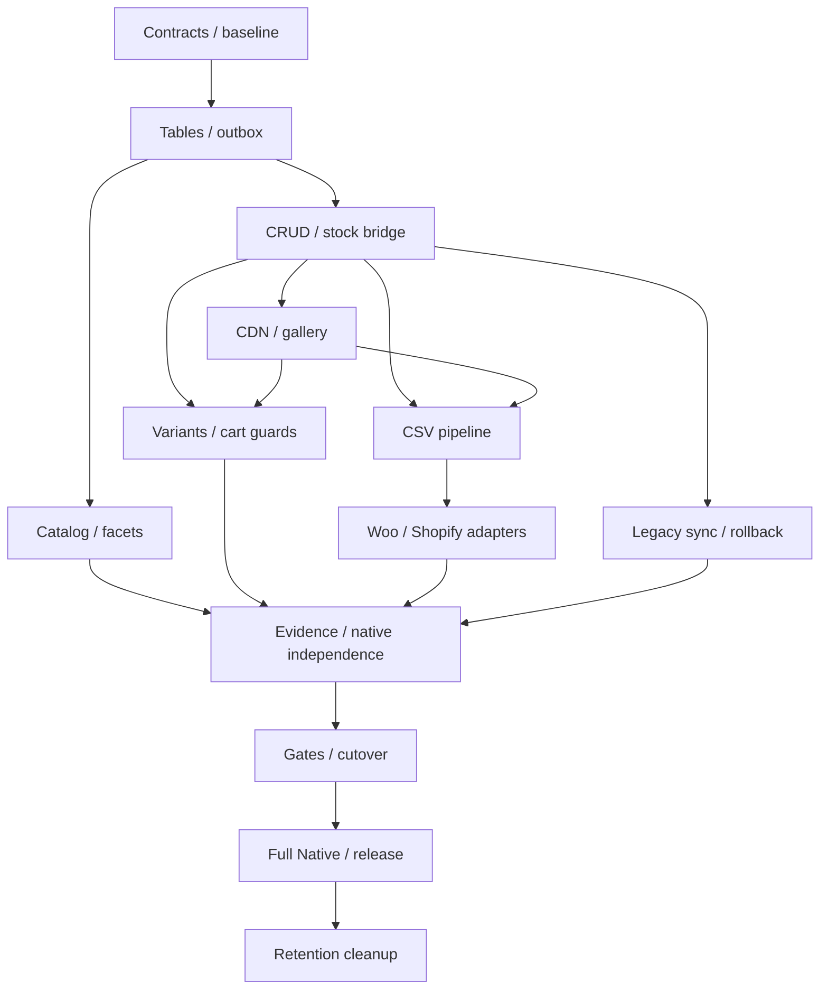

# 06 — Implementation plan

## 1. Quy trình và DoD chung

Source task IDs/names/dependencies/read-files/regression requirements tại `contracts/tasks.json`; document này là work-package view. Docs precedence 02 >03 >04 >10 >01 >09 >07 >08 >05 >06. T01/T02 đọc contracts bản draft được cung cấp, không chờ T03 seal nên không tạo bootstrap cycle. T06 phụ thuộc T09 để aggregate+outbox atomic.

DoD chung mỗi task:

1. `node scripts/check-docs.mjs --strict` exit0.
2. `node scripts/plan.mjs check` exit0.
3. Chạy task tests bằng command thật sau T02 harness: `npm run test:task -- Txx`; evidence stdout/exit của actual test process, không fake pass khi runtime chưa có.
4. `node scripts/verify-task.mjs Txx` exit0 sau result artifact đã ghi đủ test execution/acceptance; script kiểm receipt, không thay semantic test execution.
5. `node scripts/guard.mjs --staged` exit0; `git diff --check` exit0.
6. Mọi dependency completed/qa_passed evidence; no unresolved critical blocker. Cập nhật PROGRESS chỉ khi tests/acceptance pass; commit riêng task, không push.

T01 có baseline smoke command thực ở fixture harness cơ bản; không chờ T04 để pin inventory. T01 tạo baseline runner, T02 mở rộng test runner/scripts, T03 kiểm sealed contracts; runtime command chưa tồn tại thì blocked, không tính docs-only checker là runtime test pass. Bản docs creation này chưa đánh dấu task implementation done.

## 2. Work packages

### T01 — Pin baseline và compatibility inventory

**Module:** Foundation. **Phase:** P0 — Foundation. **Depends on:** không có.

**Đọc trước:** 01 §8, 02 §1, 04 §1, 10 §2; artifacts của dependency. T01/T02 dùng draft contracts hiện có; T03 seal trước các consumer implementation.

**Files:** `contracts/compatibility/pins.json`, `contracts/compatibility/matrix.json`, `docs/evidence/T01/baseline.json`, `tests/integration/T01Test.php`, `docs/evidence/T01/result.json`, `scripts/test-runtime.mjs`, `contracts/compatibility/baseline-lock.json`.

**Deliverables:** contracts/compatibility/matrix.json và pins.json; baseline-lock.json; minimal real baseline runner; docs/evidence/T01/baseline.json.

**Triển khai:** Chọn WP/WC/PHP/MariaDB versions đọc từ site1.localhost (không ma trận MySQL), một classic theme và Blocks build. Liệt kê plugin đang dùng: SEO, cache, swatches, imports, pricing, multilingual, feeds. Phân loại CRUD-safe, WP API bridge, SQL-reader, SQL-writer; ghi product types và reservation paths. T01 triển khai minimal test:task runner cho baseline smoke và source/package checksums; T02 mở rộng harness. baseline-lock.json là manifest version/checksum, không cần Composer lockfile trước T02.

**Acceptance criteria:**

- AC-T01-01 — Matrix có exact versions/baseline-lock.json/fixtures; mỗi bề mặt có owner, test và supported/blocked/unknown.
- AC-T01-02 — Không ghi “mọi Woo plugin tương thích”.
- AC-T01-03 — Direct SQL writer chưa có adapter là blocker cohort native.

**Regression tests:** R01_baseline_cart_checkout_gallery_admin_csv, R02_unknown_extension_blocks_native.

**DoD:** DoD chung 06 §1; `npm run test:task -- T01` exit0; từng requirement trên có command/output evidence hoặc observation với artifact path. Result JSON tại `docs/evidence/T01/result.json` khớp commit/env, không chứa blockers hay skipped critical tests; `node scripts/verify-task.mjs T01` exit0. Files implemented tồn tại và task dependency receipts pass.

### T02 — Plugin bootstrap và feature flags

**Module:** Foundation. **Phase:** P0 — Foundation. **Depends on:** T01.

**Đọc trước:** 01 §8, 02 §1, 04 §1, 10 §2; artifacts của dependency. T01/T02 dùng draft contracts hiện có; T03 seal trước các consumer implementation.

**Files:** `wc-product-engine.php`, `composer.json`, `package.json`, `scripts/test-runtime.mjs`, `src/Bootstrap/PluginBootstrap.php`, `tests/integration/T02Test.php`, `docs/evidence/T02/result.json`, `composer.lock`, `package-lock.json`.

**Deliverables:** Bootstrap/DI; config schema; capability registry; plugin lifecycle; WP-CLI command namespace.

**Triển khai:** Nạp plugin sau WC dependency; register Data Store đúng thời điểm, không activate native ngay khi bật plugin. Flags tách query/media/resolver/native writes; cohort routing có precedence rõ. Admin notices cho version unsupported. Deactivation không DROP data; uninstall không tự xóa bảng. Mở rộng runner do T01 tạo cho mọi task; tạo Composer/tooling lockfiles ở T02.

**Acceptance criteria:**

- AC-T02-01 — Install không đổi authority/sản phẩm; unsupported version chặn bật native.
- AC-T02-02 — Tắt feature query vẫn đọc WC ở legacy.
- AC-T02-03 — Cohort conflict không chọn ngẫu nhiên; status endpoint phản ánh config thực.

**Regression tests:** R03_activation_no_mutation, R04_flag_scope, R05_dependency_missing, R06_deactivate_retains_data.

**DoD:** DoD chung 06 §1; `npm run test:task -- T02` exit0; từng requirement trên có command/output evidence hoặc observation với artifact path. Result JSON tại `docs/evidence/T02/result.json` khớp commit/env, không chứa blockers hay skipped critical tests; `node scripts/verify-task.mjs T02` exit0. Files implemented tồn tại và task dependency receipts pass.

### T03 — Khóa database/API/event/CSV contracts

**Module:** Foundation. **Phase:** P0 — Foundation. **Depends on:** T01, T02.

**Đọc trước:** 01 §8, 02 §1, 04 §1, 10 §2; artifacts của dependency. T01/T02 dùng draft contracts hiện có; T03 seal trước các consumer implementation.

**Files:** `contracts/database/schema-contract.json`, `contracts/openapi/wpe-v1.json`, `contracts/api/endpoints.json`, `contracts/events/product-changed.schema.json`, `contracts/csv/dialects.json`, `contracts/compatibility/wc-props-mapping.json`, `tests/unit/T03Test.php`, `docs/evidence/T03/result.json`.

**Deliverables:** contracts/database/schema-contract.json; contracts/openapi/wpe-v1.json; event JSON schemas; wc-props-mapping.json; CSV dialect profiles. Executable schema.sql do T05 triển khai.

**Triển khai:** Chuyển contracts 03, 04 và 10 thành schema kiểm tra bằng máy; inventory mapping mọi WC Product/Variable/Variation prop và Data Store method, gồm callable methods ngoài interface. Chốt missing/null/empty, IDs, enums, authorization, compatibility errors. ADR cho retained shells và SKU policy.

**Acceptance criteria:**

- AC-T03-01 — OpenAPI validate pass; mọi endpoint ở matrix có request/response/errors/security; DB schema không thiếu field DTO; props chưa hỗ trợ có native blocker.
- AC-T03-02 — Breaking change cần version/ADR.

**Regression tests:** R07_contract_schema_validation, R08_decimal_id_roundtrip, R09_nullable_blank_semantics, R10_props_mapping_coverage.

**DoD:** DoD chung 06 §1; `npm run test:task -- T03` exit0; từng requirement trên có command/output evidence hoặc observation với artifact path. Result JSON tại `docs/evidence/T03/result.json` khớp commit/env, không chứa blockers hay skipped critical tests; `node scripts/verify-task.mjs T03` exit0. Files implemented tồn tại và task dependency receipts pass.

### T04 — Fixture và differential test harness

**Module:** Foundation. **Phase:** P0 — Foundation. **Depends on:** T03.

**Đọc trước:** 01 §8, 02 §1, 04 §1, 10 §2; artifacts của dependency. T01/T02 dùng draft contracts hiện có; T03 seal trước các consumer implementation.

**Files:** `src/Bootstrap/FixtureHarness.php`, `tests/integration/T04Test.php`, `docs/evidence/T04/result.json`.

**Deliverables:** Factory datasets; baseline/native runners; canonical snapshot comparator; race harness; fixture CSV từ dialect pinned.

**Triển khai:** Tạo simple/variable, 0/1/3/>3 options, 10/100/10000 variations, Any/wildcards, inherited stock, free/missing price, sale schedules/DST, Unicode labels, repeated meta, shared images, downloads và historical orders. Dùng cùng seed để so legacy/native.

**Acceptance criteria:**

- AC-T04-01 — Comparator phân biệt semantic difference và volatile timestamps; không normalize mất IDs/stock/gallery order.
- AC-T04-02 — Dataset nhỏ reproducible, dataset scale có manifest và seed.

**Regression tests:** R11_fixture_invariants, R12_diff_detects_wrong_price_stock_variant, R13_snapshot_not_hiding_errors.

**DoD:** DoD chung 06 §1; `npm run test:task -- T04` exit0; từng requirement trên có command/output evidence hoặc observation với artifact path. Result JSON tại `docs/evidence/T04/result.json` khớp commit/env, không chứa blockers hay skipped critical tests; `node scripts/verify-task.mjs T04` exit0. Files implemented tồn tại và task dependency receipts pass.

### T05 — DDL và migration runner

**Module:** Custom Tables. **Phase:** P1 — Storage và Woo compatibility. **Depends on:** T03.

**Đọc trước:** 03 §1, 03 §2, 03 §4, 03 §5, 02 §13; artifacts của dependency. T01/T02 dùng draft contracts hiện có; T03 seal trước các consumer implementation.

**Files:** `src/Infrastructure/Database/SchemaMigrator.php`, `tests/integration/T05Test.php`, `docs/evidence/T05/result.json`, `contracts/database/schema.sql`.

**Deliverables:** Schema migrations cho toàn bộ bảng phần 2; schema-version control; verify/repair CLI; migration lock.

**Triển khai:** Implement create/upgrade theo expand-contract; prefix/charset site, checks capability DB, online/backfill index theo version. DDL tách checkpoint; chỉ một migrator giữ lease. Không tạo một index lớn ở request activate. Validate precision, UTF-8, JSON text và unique registries.

**Acceptance criteria:**

- AC-T05-01 — Fresh install + upgrade N-1 + interrupted migration resume pass trên cả DB target.
- AC-T05-02 — Không khóa write dài vượt budget T01; partial schema không enable engine.
- AC-T05-03 — Không sửa bảng Core trừ writes chuẩn qua bridge.

**Regression tests:** R14_migration_idempotent, R15_prefix_multisite, R16_crash_between_ddl, R17_decimal_precision_and_collation.

**DoD:** DoD chung 06 §1; `npm run test:task -- T05` exit0; từng requirement trên có command/output evidence hoặc observation với artifact path. Result JSON tại `docs/evidence/T05/result.json` khớp commit/env, không chứa blockers hay skipped critical tests; `node scripts/verify-task.mjs T05` exit0. Files implemented tồn tại và task dependency receipts pass.

### T09 — Outbox, jobs, epoch và idempotency persistence

**Module:** Custom Tables. **Phase:** P1 — Storage và Woo compatibility. **Depends on:** T05.

**Đọc trước:** 03 §1, 03 §2, 03 §4, 03 §5, 02 §13; artifacts của dependency. T01/T02 dùng draft contracts hiện có; T03 seal trước các consumer implementation.

**Files:** `src/Infrastructure/Database/OutboxWorker.php`, `tests/integration/T09Test.php`, `docs/evidence/T09/result.json`.

**Deliverables:** Outbox writer/consumer; jobs lease/checkpoint; command receipts; control CAS; audit redaction.

**Triển khai:** Atomic native data+event+receipt transaction; consumer at-least-once, revision fence, dead-letter/replay. Epoch từ control/state; lease có expiry/owner CAS. Receipt lưu body hash/result. Hook external side effects sau commit, không replay nội dung secret.

**Acceptance criteria:**

- AC-T09-01 — Crash sau DB commit không mất event; duplicate event không revert dữ liệu mới; worker bị kill được worker khác resume; old epoch command bị reject.
- AC-T09-02 — Audit có actor/request ID.

**Regression tests:** R32_outbox_commit_crash, R33_duplicate_out_of_order_events, R34_worker_lease_takeover, R35_key_body_conflict, R36_stale_epoch.

**DoD:** DoD chung 06 §1; `npm run test:task -- T09` exit0; từng requirement trên có command/output evidence hoặc observation với artifact path. Result JSON tại `docs/evidence/T09/result.json` khớp commit/env, không chứa blockers hay skipped critical tests; `node scripts/verify-task.mjs T09` exit0. Files implemented tồn tại và task dependency receipts pass.

### T06 — Product/variant repositories và aggregate commands

**Module:** Custom Tables. **Phase:** P1 — Storage và Woo compatibility. **Depends on:** T05, T04, T09.

**Đọc trước:** 03 §1, 03 §2, 03 §4, 03 §5, 02 §13; artifacts của dependency. T01/T02 dùng draft contracts hiện có; T03 seal trước các consumer implementation.

**Files:** `src/Infrastructure/Database/ProductRepository.php`, `tests/integration/T06Test.php`, `docs/evidence/T06/result.json`, `src/Compatibility/WordPress/PostIdAllocator.php`.

**Deliverables:** Repositories; create/update/trash/restore/delete commands; SKU registry service; version CAS.

**Triển khai:** Persist canonical products/variants, links/downloads và typed props; assign ID qua real post shell allocator trong transaction adapter được kiểm chứng. Enforce one parent và SKU uniqueness cả native/legacy. Lock parent, atomic aggregate writes, IDs giữ cho orders. Soft deletion có tombstone. Minimal PostIdAllocator thuộc T06, không chờ T13; T13 hoàn thiện public shell projector/routing/factory.

**Acceptance criteria:**

- AC-T06-01 — Save rồi reload khớp canonical snapshot; duplicate SKU race chỉ một winner; invalid child/price không lưu nửa aggregate; cập nhật phiên bản và outbox transaction theo T09.
- AC-T06-02 — Legacy IDs được reuse khi migrate.

**Regression tests:** R18_aggregate_atomicity, R19_sku_race, R20_variant_wrong_parent, R21_deleted_product_order_reference, R22_stale_write_412.

**DoD:** DoD chung 06 §1; `npm run test:task -- T06` exit0; từng requirement trên có command/output evidence hoặc observation với artifact path. Result JSON tại `docs/evidence/T06/result.json` khớp commit/env, không chứa blockers hay skipped critical tests; `node scripts/verify-task.mjs T06` exit0. Files implemented tồn tại và task dependency receipts pass.

### T07 — Options, values và combination integrity

**Module:** Custom Tables. **Phase:** P1 — Storage và Woo compatibility. **Depends on:** T06.

**Đọc trước:** 03 §1, 03 §2, 03 §4, 03 §5, 02 §13; artifacts của dependency. T01/T02 dùng draft contracts hiện có; T03 seal trước các consumer implementation.

**Files:** `src/Infrastructure/Database/OptionsRepository.php`, `tests/unit/T07Test.php`, `docs/evidence/T07/result.json`.

**Deliverables:** Option repository; normalized selection model; combination key builder; defaults validation.

**Triển khai:** Hỗ trợ global/local attributes và Woo >3 options; không đồng nhất label với key. Wildcard Any giữ riêng khỏi value rỗng hợp lệ. Hash vector theo ordered option IDs/value IDs; so vector khi collision. Không generate variants ngầm khi thêm option.

**Acceptance criteria:**

- AC-T07-01 — Không có value của parent khác; defaults phải tồn tại; rename/reorder giữ identity và update key đúng.
- AC-T07-02 — Duplicate combinations được report, không silent overwrite.

**Regression tests:** R23_unicode_value_key, R24_hash_collision_simulated, R25_rename_reorder_preserve_id, R26_any_vs_empty, R27_no_cartesian_variants.

**DoD:** DoD chung 06 §1; `npm run test:task -- T07` exit0; từng requirement trên có command/output evidence hoặc observation với artifact path. Result JSON tại `docs/evidence/T07/result.json` khớp commit/env, không chứa blockers hay skipped critical tests; `node scripts/verify-task.mjs T07` exit0. Files implemented tồn tại và task dependency receipts pass.

### T08 — Media và metadata persistence

**Module:** Custom Tables. **Phase:** P1 — Storage và Woo compatibility. **Depends on:** T06, T07.

**Đọc trước:** 03 §1, 03 §2, 03 §4, 03 §5, 02 §13; artifacts của dependency. T01/T02 dùng draft contracts hiện có; T03 seal trước các consumer implementation.

**Files:** `src/Infrastructure/Database/MediaRepository.php`, `tests/integration/T08Test.php`, `docs/evidence/T08/result.json`, `src/Compatibility/WordPress/MetaIdAllocator.php`.

**Deliverables:** Asset/media repository; repeated meta adapter; extension props/download/link persistence.

**Triển khai:** Ghi ordered featured/gallery/variant media; shared refs không cascade xóa. WC meta có meta_id và serialization giữ nguyên. Source Shopify fields không đại diện được lưu namespaced extension có version, không trộn vào price query. MetaIdAllocator reserve ID thật wp_postmeta; không dùng AUTO namespace native độc lập (03 §5).

**Acceptance criteria:**

- AC-T08-01 — Một featured/primary hợp lệ; thay gallery atomic; malformed JSON/foreign asset reject.
- AC-T08-02 — Repeated metadata và downloadable props survive save/reload.

**Regression tests:** R28_gallery_order, R29_shared_asset_delete, R30_meta_serialized_repeated_ids, R31_download_ids_preserved.

**DoD:** DoD chung 06 §1; `npm run test:task -- T08` exit0; từng requirement trên có command/output evidence hoặc observation với artifact path. Result JSON tại `docs/evidence/T08/result.json` khớp commit/env, không chứa blockers hay skipped critical tests; `node scripts/verify-task.mjs T08` exit0. Files implemented tồn tại và task dependency receipts pass.

### T10 — Woo Product Data Stores

**Module:** CRUD Compatibility. **Phase:** P1 — Storage và Woo compatibility. **Depends on:** T06, T07, T08, T09.

**Đọc trước:** 02 §4, 02 §8, 03 §5, 10 §2; artifacts của dependency. T01/T02 dùng draft contracts hiện có; T03 seal trước các consumer implementation.

**Files:** `src/Compatibility/WooDataStore/ProductDataStore.php`, `tests/integration/T10Test.php`, `docs/evidence/T10/result.json`.

**Deliverables:** Simple/variable/variation Data Store adapters; registration filters; method parity report.

**Triển khai:** Implement đúng interface pinned và methods product lookup/query, children, matching variation, price sync, SKU, stock, counts, sale lists, feature lists. Chặn inherited CPT method đọc postmeta vô tình. WC factory/discovery được bridge T13; preserve get_changes/apply_changes/set_object_read lifecycle.

**Acceptance criteria:**

- AC-T10-01 — Direct WC_Product_Simple/Variable/Variation save/read/getters/setters và Data Store ID query methods đúng classes/IDs.
- AC-T10-02 — Factory/permalink qua wc_get_product được chứng nhận T13; full wc_get_products query surfaces T19.
- AC-T10-03 — Mọi methods mapping T03 có integration test trong scope trực tiếp, không chỉ 4 CRUD methods.

**Regression tests:** R37_datastore_interface_parity, R38_wc_object_class_and_hydration, R39_children_and_price_sync, R40_no_hidden_cpt_method_reads.

**DoD:** DoD chung 06 §1; `npm run test:task -- T10` exit0; từng requirement trên có command/output evidence hoặc observation với artifact path. Result JSON tại `docs/evidence/T10/result.json` khớp commit/env, không chứa blockers hay skipped critical tests; `node scripts/verify-task.mjs T10` exit0. Files implemented tồn tại và task dependency receipts pass.

### T11 — WC metadata và WordPress metadata bridge

**Module:** CRUD Compatibility. **Phase:** P1 — Storage và Woo compatibility. **Depends on:** T10.

**Đọc trước:** 02 §4, 02 §8, 03 §5, 10 §2; artifacts của dependency. T01/T02 dùng draft contracts hiện có; T03 seal trước các consumer implementation.

**Files:** `src/Compatibility/WooDataStore/MetaBridge.php`, `tests/integration/T11Test.php`, `docs/evidence/T11/result.json`.

**Deliverables:** WC meta CRUD; allowlisted WordPress metadata filters; owned-key registry; compatibility conflict report.

**Triển khai:** Map known WC internal meta sang typed fields; arbitrary extension meta giữ source rõ theo authority. Adapter get/update/add/delete_post_meta cho key đã chứng nhận, giữ empty/single/repeated semantics và no-op return. Bypass guard theo request context để không sync loop.

**Acceptance criteria:**

- AC-T11-01 — get_post_meta và WC read_meta_data thống nhất trên owned keys trong supported mode; direct WP API writes có validation và event.
- AC-T11-02 — Unknown SQL writer không được mặc nhiên native.

**Regression tests:** R41_meta_bridge_single_multiple, R42_wp_meta_noop_return, R43_recursive_hook_guard, R44_unknown_meta_retention.

**DoD:** DoD chung 06 §1; `npm run test:task -- T11` exit0; từng requirement trên có command/output evidence hoặc observation với artifact path. Result JSON tại `docs/evidence/T11/result.json` khớp commit/env, không chứa blockers hay skipped critical tests; `node scripts/verify-task.mjs T11` exit0. Files implemented tồn tại và task dependency receipts pass.

### T12 — Stock owner, reservation và order lifecycle

**Module:** CRUD Compatibility. **Phase:** P1 — Storage và Woo compatibility. **Depends on:** T10, T09.

**Đọc trước:** 02 §4, 02 §8, 03 §5, 10 §2; artifacts của dependency. T01/T02 dùng draft contracts hiện có; T03 seal trước các consumer implementation.

**Files:** `src/Compatibility/WooDataStore/InventoryBridge.php`, `tests/integration/T12Test.php`, `docs/evidence/T12/result.json`.

**Deliverables:** Inventory Data Store methods; atomic stock commands; reservation adapter; order transition idempotency.

**Triển khai:** Trace wc_update_product_stock, reserve/hold/reduce/restore, checkout classic/Blocks và HPOS modes trên pinned WC. Chọn một reservation backend mỗi cohort; custom helper qua extension point hợp lệ hoặc giữ mode bị block nếu không thể thay. Implement parent inheritance, backorders, sold individually, low stock và partial refunds.

**Acceptance criteria:**

- AC-T12-01 — Concurrent buyers cuối stock không oversell khi no-backorder; duplicate webhook/retry không double-reduce; cancel/fail/timeout release đúng.
- AC-T12-02 — Không đọc quantity stale từ postmeta/lookup tại checkout native.
- AC-T12-03 — Không thay order/payment engine.

**Regression tests:** R45_last_unit_race, R46_parent_stock_shared_variants, R47_reserve_expiry_and_own_order, R48_payment_retry_reduce_once, R49_partial_refund_restock, R50_hpos_and_legacy_orders.

**DoD:** DoD chung 06 §1; `npm run test:task -- T12` exit0; từng requirement trên có command/output evidence hoặc observation với artifact path. Result JSON tại `docs/evidence/T12/result.json` khớp commit/env, không chứa blockers hay skipped critical tests; `node scripts/verify-task.mjs T12` exit0. Files implemented tồn tại và task dependency receipts pass.

### T13 — Post shell, factory, taxonomy và permalink bridge

**Module:** CRUD Compatibility. **Phase:** P1 — Storage và Woo compatibility. **Depends on:** T10, T11.

**Đọc trước:** 02 §4, 02 §8, 03 §5, 10 §2; artifacts của dependency. T01/T02 dùng draft contracts hiện có; T03 seal trước các consumer implementation.

**Files:** `src/Compatibility/WooDataStore/PostShellBridge.php`, `tests/integration/T13Test.php`, `docs/evidence/T13/result.json`.

**Deliverables:** Real ID allocator; shell projector; discovery/routing adapters; term/review bridge.

**Triển khai:** Giữ shell product/variation type/title/status/slug/parent và lifecycle thông qua WP APIs. Taxonomy/reviews vẫn WP authoritative; versioned projection native index. Product factory có thể đọc CPT/terms nên không xóa shell. WP_Query không được coi tự native chỉ vì thay Data Store.

**Acceptance criteria:**

- AC-T13-01 — Permalink cũ/new slug redirects và variation discovery ổn; get_post_type/reviews/category counts phù hợp policy.
- AC-T13-02 — Non-product posts không bị can thiệp; shell-only không chứa stock/price canonical.

**Regression tests:** R51_permalink_factory_ids, R52_taxonomy_hierarchy, R53_reviews_rating_projection, R54_nonproduct_queries_unchanged.

**DoD:** DoD chung 06 §1; `npm run test:task -- T13` exit0; từng requirement trên có command/output evidence hoặc observation với artifact path. Result JSON tại `docs/evidence/T13/result.json` khớp commit/env, không chứa blockers hay skipped critical tests; `node scripts/verify-task.mjs T13` exit0. Files implemented tồn tại và task dependency receipts pass.

### T14 — WC admin, REST v3 và Store API adapters

**Module:** CRUD Compatibility. **Phase:** P1 — Storage và Woo compatibility. **Depends on:** T13, T12, T07.

**Đọc trước:** 02 §4, 02 §8, 03 §5, 10 §2; artifacts của dependency. T01/T02 dùng draft contracts hiện có; T03 seal trước các consumer implementation.

**Files:** `src/Compatibility/WooDataStore/AdminApiBridge.php`, `tests/integration/T14Test.php`, `docs/evidence/T14/result.json`.

**Deliverables:** Admin product edit/list/bulk actions; REST adapter coverage; Store API/Blocks integration report.

**Triển khai:** Trace CRUD và query thực cho edit, quick edit, bulk edit, duplicate, REST product/variation CRUD, Store API images/attributes/cart. Bridge query riêng từng surface; permissions object-level, không chỉ manage_woocommerce. Unknown meta query hiện warning/unsupported/fallback theo mode.

**Acceptance criteria:**

- AC-T14-01 — Tạo/sửa/xóa qua WC admin và WC REST tồn tại cùng dữ liệu engine; public API không lộ draft/private/cost.
- AC-T14-02 — Unsupported query chỉ fallback ở legacy authority, không query stale native postmeta.

**Regression tests:** R55_admin_crud_bulk_duplicate, R56_wc_rest_product_variation_roundtrip, R57_store_api_no_private_leak, R58_object_capability_denial.

**DoD:** DoD chung 06 §1; `npm run test:task -- T14` exit0; từng requirement trên có command/output evidence hoặc observation với artifact path. Result JSON tại `docs/evidence/T14/result.json` khớp commit/env, không chứa blockers hay skipped critical tests; `node scripts/verify-task.mjs T14` exit0. Files implemented tồn tại và task dependency receipts pass.

### T15 — Hooks, product transitions và cache lifecycle

**Module:** CRUD Compatibility. **Phase:** P1 — Storage và Woo compatibility. **Depends on:** T10, T11, T12, T13.

**Đọc trước:** 02 §4, 02 §8, 03 §5, 10 §2; artifacts của dependency. T01/T02 dùng draft contracts hiện có; T03 seal trước các consumer implementation.

**Files:** `src/Compatibility/WooDataStore/ProductLifecycle.php`, `tests/integration/T15Test.php`, `docs/evidence/T15/result.json`.

**Deliverables:** Lifecycle action matrix; transition commands; cache invalidation integration.

**Triển khai:** Preserve các action payload/timing cần tương thích theo fixture, dispatch sau commit và chống duplicate do mirror. Test simple↔variable có preview/remap, trash/restore/permanent delete. Cache WC object/transient và Redis persistent không giữ wrong type/price sau save.

**Acceptance criteria:**

- AC-T15-01 — Supported subscribers nhận events có đúng ID/object và trạng thái commit.
- AC-T15-02 — Không hứa exactly-once action trong mọi crash; subscriber stock dùng durable operation key.
- AC-T15-03 — Destructive transition không làm mất historical variation references.

**Regression tests:** R59_hooks_payload_and_order, R60_type_transition_order_history, R61_persistent_cache_after_update, R62_projection_not_emitting_business_write_twice.

**DoD:** DoD chung 06 §1; `npm run test:task -- T15` exit0; từng requirement trên có command/output evidence hoặc observation với artifact path. Result JSON tại `docs/evidence/T15/result.json` khớp commit/env, không chứa blockers hay skipped critical tests; `node scripts/verify-task.mjs T15` exit0. Files implemented tồn tại và task dependency receipts pass.

### T16 — Projection builder và generation rebuild

**Module:** Catalog Index. **Phase:** P2 — Catalog/media/variants. **Depends on:** T06, T07, T08, T09.

**Đọc trước:** 02 §9, 03 §4, 04 §1.3, 07 §6; artifacts của dependency. T01/T02 dùng draft contracts hiện có; T03 seal trước các consumer implementation.

**Files:** `src/Application/Catalog/CatalogProjector.php`, `tests/integration/T16Test.php`, `docs/evidence/T16/result.json`.

**Deliverables:** Catalog/facet projector; active generation pointer; rebuild/resume commands; lag metrics.

**Triển khai:** Đọc canonical theo authority; compute min/max purchasable variation prices, on_sale/stock/ratings/sales từ sources rõ. Build generation mới side-by-side, catch-up revision fence rồi atomic switch; tombstone không resurrect. Stock/sale boundary/review/order updates trigger index.

**Acceptance criteria:**

- AC-T16-01 — Dirty product cuối rebuild vẫn đúng; previous generation giữ đến cursor expiry.
- AC-T16-02 — Price schedule tự chuyển dù không save.
- AC-T16-03 — No orphan facets và source_version audit pass.

**Regression tests:** R63_rebuild_under_writes, R64_tombstone_no_resurrection, R65_sale_clock_boundary_dst, R66_generation_cursor_retention.

**DoD:** DoD chung 06 §1; `npm run test:task -- T16` exit0; từng requirement trên có command/output evidence hoặc observation với artifact path. Result JSON tại `docs/evidence/T16/result.json` khớp commit/env, không chứa blockers hay skipped critical tests; `node scripts/verify-task.mjs T16` exit0. Files implemented tồn tại và task dependency receipts pass.

### T17 — Fast query compiler và keyset pagination

**Module:** Catalog Index. **Phase:** P2 — Catalog/media/variants. **Depends on:** T16, T03.

**Đọc trước:** 02 §9, 03 §4, 04 §1.3, 07 §6; artifacts của dependency. T01/T02 dùng draft contracts hiện có; T03 seal trước các consumer implementation.

**Files:** `src/Application/Catalog/CatalogQuery.php`, `tests/integration/T17Test.php`, `docs/evidence/T17/result.json`.

**Deliverables:** Typed filter grammar; parameterized SQL compiler; catalog public endpoint; cursor signer.

**Triển khai:** Compile supported filter/sort thành bounded prepared SQL trên index tables; stable ID tie-break và null handling. Validate sort/query hash/epoch/expiry cursor. Batch hydration/card projection, không SELECT mọi matching ID. Separate exact count khi cần.

**Acceptance criteria:**

- AC-T17-01 — Result IDs/order khớp fixture semantic mode; injection/cursor tamper reject; page 1 size đúng không N+1 theo số matches.
- AC-T17-02 — Live traversal semantics documented, export không reuse cursor như snapshot.

**Regression tests:** R67_filter_sort_diff, R68_equal_price_cursor_tie, R69_cursor_tamper_query_mismatch, R70_limit_cap_and_null_price.

**DoD:** DoD chung 06 §1; `npm run test:task -- T17` exit0; từng requirement trên có command/output evidence hoặc observation với artifact path. Result JSON tại `docs/evidence/T17/result.json` khớp commit/env, không chứa blockers hay skipped critical tests; `node scripts/verify-task.mjs T17` exit0. Files implemented tồn tại và task dependency receipts pass.

### T18 — Facets coherent theo variant và counts

**Module:** Catalog Index. **Phase:** P2 — Catalog/media/variants. **Depends on:** T17, T07.

**Đọc trước:** 02 §9, 03 §4, 04 §1.3, 07 §6; artifacts của dependency. T01/T02 dùng draft contracts hiện có; T03 seal trước các consumer implementation.

**Files:** `src/Application/Catalog/FacetQuery.php`, `tests/integration/T18Test.php`, `docs/evidence/T18/result.json`.

**Deliverables:** Facet query service; disjunctive count contract; variant-coherent/WC-compatible policies.

**Triển khai:** AND khác facet, OR cùng facet; variation filters join cùng variation, inheritance stock resolve. Category descendants expand theo term version. Count distinct parents, self-exclude current facet; price facet policy và stock/backorder policy rõ.

**Acceptance criteria:**

- AC-T18-01 — Black-M/White-L không match Black-L trong coherent mode; counts không double khi nhiều variants/terms; WC-compatible fixture nếu khác được tách tên/mode.

**Regression tests:** R71_impossible_combination_filter, R72_distinct_parent_counts, R73_self_exclusion_facets, R74_category_descendants_deleted_term.

**DoD:** DoD chung 06 §1; `npm run test:task -- T18` exit0; từng requirement trên có command/output evidence hoặc observation với artifact path. Result JSON tại `docs/evidence/T18/result.json` khớp commit/env, không chứa blockers hay skipped critical tests; `node scripts/verify-task.mjs T18` exit0. Files implemented tồn tại và task dependency receipts pass.

### T19 — Tích hợp wc_get_products, shop archives và admin lists

**Module:** Catalog Index. **Phase:** P2 — Catalog/media/variants. **Depends on:** T17, T18, T14.

**Đọc trước:** 02 §9, 03 §4, 04 §1.3, 07 §6; artifacts của dependency. T01/T02 dùng draft contracts hiện có; T03 seal trước các consumer implementation.

**Files:** `src/Application/Catalog/CatalogAdapters.php`, `tests/integration/T19Test.php`, `docs/evidence/T19/result.json`.

**Deliverables:** Scoped Woo query/Data Store adapters; archive pagination integration; block query adapter; query capability registry.

**Triển khai:** Shop/category/tag/attribute listing dùng engine cho queries chứng nhận, giữ WP loop pagination/total/visibility. Numbered pages giữ query/count riêng; deep page budget/cap. Query không hỗ trợ explicit fallback legacy hoặc native feature blocker; không chèn triệu IDs vào post__in.

**Acceptance criteria:**

- AC-T19-01 — Classic pagination, layered nav, Woo REST list và chosen Blocks product collection cho đúng IDs/totals.
- AC-T19-02 — Main WP_Query non-product không đổi.
- AC-T19-03 — Query unsupported không trả list “thành công” thiếu điều kiện.

**Regression tests:** R75_archive_pagination_found_posts, R76_wc_query_args_coverage, R77_blocks_listing, R78_unsupported_filter_no_silent_omission.

**DoD:** DoD chung 06 §1; `npm run test:task -- T19` exit0; từng requirement trên có command/output evidence hoặc observation với artifact path. Result JSON tại `docs/evidence/T19/result.json` khớp commit/env, không chứa blockers hay skipped critical tests; `node scripts/verify-task.mjs T19` exit0. Files implemented tồn tại và task dependency receipts pass.

### T20 — Cache context, invalidation và pricing compatibility

**Module:** Catalog Index. **Phase:** P2 — Catalog/media/variants. **Depends on:** T19, T15.

**Đọc trước:** 02 §9, 03 §4, 04 §1.3, 07 §6; artifacts của dependency. T01/T02 dùng draft contracts hiện có; T03 seal trước các consumer implementation.

**Files:** `src/Application/Catalog/ContextCache.php`, `tests/integration/T20Test.php`, `docs/evidence/T20/result.json`.

**Deliverables:** Cache keys/context policy; epoch/generation invalidation; freshness display; pricing compatibility gate.

**Triển khai:** Cache theo filter/sort/generation/locale/currency/customer-price context allowlist; bounded TTL và stampede protection. Delete/update invalidate via revision. Dynamic price filter không representable trước pagination phải disable engine price filter cho surface đó hoặc block native feature.

**Acceptance criteria:**

- AC-T20-01 — Hai tax/customer/currency contexts không dùng chung giá; changed visibility không leak draft qua cache.
- AC-T20-02 — Outbox backlog có observable lag và fallback chỉ về canonical đúng authority.

**Regression tests:** R79_context_cache_isolation, R80_visibility_cache_invalidate, R81_cache_stampede, R82_dynamic_price_filter_before_pagination.

**DoD:** DoD chung 06 §1; `npm run test:task -- T20` exit0; từng requirement trên có command/output evidence hoặc observation với artifact path. Result JSON tại `docs/evidence/T20/result.json` khớp commit/env, không chứa blockers hay skipped critical tests; `node scripts/verify-task.mjs T20` exit0. Files implemented tồn tại và task dependency receipts pass.

### T21 — URL registry, providers và rendition contract

**Module:** External CDN Images. **Phase:** P2 — Catalog/media/variants. **Depends on:** T08, T09.

**Đọc trước:** 03 §3, 09 §4, 10 §3, 10 §4; artifacts của dependency. T01/T02 dùng draft contracts hiện có; T03 seal trước các consumer implementation.

**Files:** `src/Compatibility/Gallery/AssetService.php`, `tests/integration/T21Test.php`, `docs/evidence/T21/result.json`.

**Deliverables:** Asset service; provider interface; URL validator; health-check workers.

**Triển khai:** URL dedup so exact canonical URL, giữ query/version; provider mapping widths/formats explicit. HTTPS/image MIME policy, DNS/redirect SSRF checks khi fetch, timeout/body limit; health probes chạy background. Signed delivery separate stable provider key.

**Acceptance criteria:**

- AC-T21-01 — Không network call từng ảnh khi render; invalid/private redirect không fetch; duplicate URL idempotent nhưng per-product alt vẫn riêng.
- AC-T21-02 — Broken URL có placeholder, không làm PDP fatal.

**Regression tests:** R83_ssrf_redirect_dns, R84_url_query_not_stripped, R85_rendition_dimensions, R86_render_no_network_probe.

**DoD:** DoD chung 06 §1; `npm run test:task -- T21` exit0; từng requirement trên có command/output evidence hoặc observation với artifact path. Result JSON tại `docs/evidence/T21/result.json` khớp commit/env, không chứa blockers hay skipped critical tests; `node scripts/verify-task.mjs T21` exit0. Files implemented tồn tại và task dependency receipts pass.

### T22 — Real attachment bridge và Media Library behavior

**Module:** External CDN Images. **Phase:** P2 — Catalog/media/variants. **Depends on:** T21, T13, T11.

**Đọc trước:** 03 §3, 09 §4, 10 §3, 10 §4; artifacts của dependency. T01/T02 dùng draft contracts hiện có; T03 seal trước các consumer implementation.

**Files:** `src/Compatibility/Gallery/AttachmentBridge.php`, `tests/integration/T22Test.php`, `docs/evidence/T22/result.json`.

**Deliverables:** Lazy/eager attachment bridge policy; WP image filters; attachment mapping migration.

**Triển khai:** Cấp ID attachment thật cho assets cần native gallery; metadata dimensions/renditions/alt; WP image URL/downsize/srcset adapters scoped đúng attachment. Không fake local files cho crop/regeneration. Shared deletion safeguards và media REST preview.

**Acceptance criteria:**

- AC-T22-01 — wp_get_attachment_image và Media Library preview thấy CDN ảnh đúng; bridge không tạo attachment trùng khi race.
- AC-T22-02 — Delete attachment có references tạo warning/rebind policy, không xóa CDN ngoài.

**Regression tests:** R87_real_attachment_race, R88_wp_image_srcset_metadata, R89_local_file_actions_explicit, R90_shared_attachment_delete.

**DoD:** DoD chung 06 §1; `npm run test:task -- T22` exit0; từng requirement trên có command/output evidence hoặc observation với artifact path. Result JSON tại `docs/evidence/T22/result.json` khớp commit/env, không chứa blockers hay skipped critical tests; `node scripts/verify-task.mjs T22` exit0. Files implemented tồn tại và task dependency receipts pass.

### T23 — Native gallery và variation image payload

**Module:** External CDN Images. **Phase:** P2 — Catalog/media/variants. **Depends on:** T22, T10.

**Đọc trước:** 03 §3, 09 §4, 10 §3, 10 §4; artifacts của dependency. T01/T02 dùng draft contracts hiện có; T03 seal trước các consumer implementation.

**Files:** `src/Compatibility/Gallery/GalleryAdapter.php`, `tests/integration/T23Test.php`, `docs/evidence/T23/result.json`.

**Deliverables:** Gallery mapping adapter; classic template integration; variant image serializer; reset behavior.

**Triển khai:** Giữ WC gallery markup/hooks, featured/gallery order và thumbnails. Variant primary và multi-image extension có deterministic fallback; native Woo contract chỉ primary, multi-image gallery của engine qua JS adapter. Reset trả parent featured/gallery.

**Acceptance criteria:**

- AC-T23-01 — Zoom/lightbox/swipe/keyboard và chọn/reset variation chạy; kích thước srcset đúng, không thumbnail ảnh A full_src ảnh B.
- AC-T23-02 — Không cần sửa WC template Core.

**Regression tests:** R91_classic_gallery_zoom_lightbox, R92_variant_image_reset, R93_multiple_variant_images, R94_missing_image_fallback.

**DoD:** DoD chung 06 §1; `npm run test:task -- T23` exit0; từng requirement trên có command/output evidence hoặc observation với artifact path. Result JSON tại `docs/evidence/T23/result.json` khớp commit/env, không chứa blockers hay skipped critical tests; `node scripts/verify-task.mjs T23` exit0. Files implemented tồn tại và task dependency receipts pass.

### T24 — Ảnh trên cart/email/SEO/feed/Blocks

**Module:** External CDN Images. **Phase:** P2 — Catalog/media/variants. **Depends on:** T23, T14.

**Đọc trước:** 03 §3, 09 §4, 10 §3, 10 §4; artifacts của dependency. T01/T02 dùng draft contracts hiện có; T03 seal trước các consumer implementation.

**Files:** `src/Compatibility/Gallery/ImageSurfaces.php`, `tests/integration/T24Test.php`, `docs/evidence/T24/result.json`.

**Deliverables:** Cart/order/email image adapters; schema/feed/SEO compatibility matrix; Blocks image adapter.

**Triển khai:** Thử featured/variant ảnh trên cart, mini-cart, checkout, order history/email và WC schema. Certify SEO plugin chosen; sitemap/social/feed link CDN stable. Chặn private token URL trong public/export. Blocks gallery/API cần test riêng.

**Acceptance criteria:**

- AC-T24-01 — Ảnh đúng variation trên các surfaces; OG/schema không rỗng; alt override policy rõ nơi chỉ một attachment alt được hỗ trợ.
- AC-T24-02 — Unsupported SEO/feed plugin được ghi blocked/unknown.

**Regression tests:** R95_cart_email_variant_image, R96_schema_og_sitemap, R97_blocks_gallery, R98_no_signed_secret_url_exposure.

**DoD:** DoD chung 06 §1; `npm run test:task -- T24` exit0; từng requirement trên có command/output evidence hoặc observation với artifact path. Result JSON tại `docs/evidence/T24/result.json` khớp commit/env, không chứa blockers hay skipped critical tests; `node scripts/verify-task.mjs T24` exit0. Files implemented tồn tại và task dependency receipts pass.

### T25 — Server resolver và allowed-values engine

**Module:** Variant Selector. **Phase:** P2 — Catalog/media/variants. **Depends on:** T07, T10, T12.

**Đọc trước:** 02 §7, 02 §8, 04 §3, 09 §3; artifacts của dependency. T01/T02 dùng draft contracts hiện có; T03 seal trước các consumer implementation.

**Files:** `src/Application/Variant/VariantResolver.php`, `tests/integration/T25Test.php`, `docs/evidence/T25/result.json`.

**Deliverables:** Resolve service; selection normalization; wildcard precedence policy; bounded candidate queries.

**Triển khai:** Partial/full selection theo options IDs và existing combinations; no Cartesian. Match WC wildcard baseline thứ tự đã pin; stock/price/current revision canonical. Allowed exists/purchasable tách, batch query tránh scan JSON tất cả variations.

**Acceptance criteria:**

- AC-T25-01 — None/partial/exact/ambiguous states đúng fixtures, inherited stock đúng; free vs missing price khác.
- AC-T25-02 — Duplicate overlapping Any được report, không random selection.

**Regression tests:** R99_partial_allowed_values, R100_wildcard_precedence_diff, R101_stock_price_revision, R102_unknown_option_wrong_product.

**DoD:** DoD chung 06 §1; `npm run test:task -- T25` exit0; từng requirement trên có command/output evidence hoặc observation với artifact path. Result JSON tại `docs/evidence/T25/result.json` khớp commit/env, không chứa blockers hay skipped critical tests; `node scripts/verify-task.mjs T25` exit0. Files implemented tồn tại và task dependency receipts pass.

### T26 — Resolver API và native AJAX variation adapter

**Module:** Variant Selector. **Phase:** P2 — Catalog/media/variants. **Depends on:** T25, T23, T03.

**Đọc trước:** 02 §7, 02 §8, 04 §3, 09 §3; artifacts của dependency. T01/T02 dùng draft contracts hiện có; T03 seal trước các consumer implementation.

**Files:** `src/Application/Variant/ResolverApi.php`, `tests/integration/T26Test.php`, `docs/evidence/T26/result.json`.

**Deliverables:** POST resolve route; wc-ajax variation adapter; serializer; ETag/rate-limits.

**Triển khai:** Support Woo native variation resolution path và engine path; event/payload expected JS contract. Public only visible products/variants. request_sequence echo, revision mismatch actionable; resolver không reserve stock. Limit selection size/quantity malformed input.

**Acceptance criteria:**

- AC-T26-01 — Classic get_variation AJAX trả hợp lệ; engine resolver không expose draft/meta.
- AC-T26-02 — Empty selection không hydrate 10k variations; rate limit phản hồi có retry hint.

**Regression tests:** R103_wc_ajax_variation_payload, R104_public_resolver_permissions, R105_payload_limits, R106_revision_refresh.

**DoD:** DoD chung 06 §1; `npm run test:task -- T26` exit0; từng requirement trên có command/output evidence hoặc observation với artifact path. Result JSON tại `docs/evidence/T26/result.json` khớp commit/env, không chứa blockers hay skipped critical tests; `node scripts/verify-task.mjs T26` exit0. Files implemented tồn tại và task dependency receipts pass.

### T27 — Selector UI, swatches và asynchronous behavior

**Module:** Variant Selector. **Phase:** P2 — Catalog/media/variants. **Depends on:** T26, T24.

**Đọc trước:** 02 §7, 02 §8, 04 §3, 09 §3; artifacts của dependency. T01/T02 dùng draft contracts hiện có; T03 seal trước các consumer implementation.

**Files:** `assets/variant-selector/selector.js`, `assets/variant-selector/selector.css`, `src/Compatibility/StoreApi/SelectorAdapter.php`, `tests/integration/T27Test.php`, `docs/evidence/T27/result.json`.

**Deliverables:** Accessible option controls; selector state machine; classic/Blocks adapters; performance trace.

**Triển khai:** Dropdown baseline, optional color/image swatches đọc metadata; disable impossible values, loading state, price/stock/image update. Abort/sequence stale requests; reset default selection; form variation_id/attributes theo WC. Enqueue chỉ PDP cần dùng.

**Acceptance criteria:**

- AC-T27-01 — Keyboard/screen-reader dùng được; fast switching không chọn sai variant hoặc stale image.
- AC-T27-02 — Product 10k variations không embed toàn JSON; responsive không mất selection.

**Regression tests:** R107_out_of_order_responses, R108_keyboard_accessibility, R109_reset_defaults, R110_large_variant_payload_budget.

**DoD:** DoD chung 06 §1; `npm run test:task -- T27` exit0; từng requirement trên có command/output evidence hoặc observation với artifact path. Result JSON tại `docs/evidence/T27/result.json` khớp commit/env, không chứa blockers hay skipped critical tests; `node scripts/verify-task.mjs T27` exit0. Files implemented tồn tại và task dependency receipts pass.

### T28 — Server add-to-cart validation và session restore

**Module:** Variant Selector. **Phase:** P2 — Catalog/media/variants. **Depends on:** T27, T12, T15.

**Đọc trước:** 02 §7, 02 §8, 04 §3, 09 §3; artifacts của dependency. T01/T02 dùng draft contracts hiện có; T03 seal trước các consumer implementation.

**Files:** `src/Application/Variant/CartValidation.php`, `tests/integration/T28Test.php`, `docs/evidence/T28/result.json`.

**Deliverables:** Classic/Store API add-to-cart guards; cart revalidation; session persistence tests.

**Triển khai:** Validate parent/variant/options ownership, current purchasability/price/stock/sold-individually tại server. Cart restore xử lý variant deleted/changed, không tin UI price. Giữ metadata customization của plugin đã chứng nhận, không biến resolver thành payment endpoint.

**Acceptance criteria:**

- AC-T28-01 — Tampered variant hoặc price không mua được; stale stock bị xử lý rõ; cart restore sau migrate giữ IDs, invalid variation báo người dùng.
- AC-T28-02 — Classic và Blocks parity.

**Regression tests:** R111_tampered_cart_payload, R112_stock_changed_after_resolve, R113_cart_session_after_migration, R114_custom_cart_meta_retention.

**DoD:** DoD chung 06 §1; `npm run test:task -- T28` exit0; từng requirement trên có command/output evidence hoặc observation với artifact path. Result JSON tại `docs/evidence/T28/result.json` khớp commit/env, không chứa blockers hay skipped critical tests; `node scripts/verify-task.mjs T28` exit0. Files implemented tồn tại và task dependency receipts pass.

### T29 — Streaming parser, staging và dry-run validation

**Module:** CSV Pipeline. **Phase:** P3 — CSV interchange. **Depends on:** T03, T09, T07, T21.

**Đọc trước:** 02 §11, 04 §2, 10 §6, 09 §5; artifacts của dependency. T01/T02 dùng draft contracts hiện có; T03 seal trước các consumer implementation.

**Files:** `src/Application/ImportExport/CsvStager.php`, `tests/integration/T29Test.php`, `docs/evidence/T29/result.json`.

**Deliverables:** Private upload/staging; dialect detection; validator; dry-run report and immutable file hash.

**Triển khai:** Streaming UTF-8/BOM/quoted multiline; preserve missing vs blank; limits file/field/row, no arbitrary path fetch. Stage shuffled parent/child rows rồi group trên DB/disk. Dry-run validate SKU/options/images/type/capability, không create products/terms/attachments.

**Acceptance criteria:**

- AC-T29-01 — Dry-run không mutation catalog; malformed row giữ exact row/column error.
- AC-T29-02 — File/config sửa sau validation làm commit reject; file 1M rows không giữ RAM tỷ lệ kích thước toàn file.

**Regression tests:** R115_csv_multiline_quotes_bom, R116_dryrun_no_side_effects, R117_group_shuffled_rows, R118_large_csv_memory, R119_private_upload_permissions.

**DoD:** DoD chung 06 §1; `npm run test:task -- T29` exit0; từng requirement trên có command/output evidence hoặc observation với artifact path. Result JSON tại `docs/evidence/T29/result.json` khớp commit/env, không chứa blockers hay skipped critical tests; `node scripts/verify-task.mjs T29` exit0. Files implemented tồn tại và task dependency receipts pass.

### T30 — Commit worker, resume và conflict policy

**Module:** CSV Pipeline. **Phase:** P3 — CSV interchange. **Depends on:** T29, T10, T09.

**Đọc trước:** 02 §11, 04 §2, 10 §6, 09 §5; artifacts của dependency. T01/T02 dùng draft contracts hiện có; T03 seal trước các consumer implementation.

**Files:** `src/Application/ImportExport/ImportCommitter.php`, `tests/integration/T30Test.php`, `docs/evidence/T30/result.json`.

**Deliverables:** Per-product committer; chunk checkpoints; import idempotency; cancel and row reports.

**Triển khai:** Reuse domain/WC commands theo authority, không raw bulk insert bỏ validation/events. Atomically group parent/options/variants; limit giant group và spill. Actor permissions recheck, version conflicts fail/skip policy explicit. Cancel sau commit boundary; retry không duplicate attachments/stock.

**Acceptance criteria:**

- AC-T30-01 — Worker crash/resume tạo đúng số products/variants; một group invalid không half-save; rows failed/skipped/success counts khớp.
- AC-T30-02 — Không overwrite edit mới giữa dry-run và commit.

**Regression tests:** R120_import_crash_resume, R121_import_group_atomic, R122_import_vs_admin_conflict, R123_cancel_partial_commit_report.

**DoD:** DoD chung 06 §1; `npm run test:task -- T30` exit0; từng requirement trên có command/output evidence hoặc observation với artifact path. Result JSON tại `docs/evidence/T30/result.json` khớp commit/env, không chứa blockers hay skipped critical tests; `node scripts/verify-task.mjs T30` exit0. Files implemented tồn tại và task dependency receipts pass.

### T31 — Snapshot export và secure report delivery

**Module:** CSV Pipeline. **Phase:** P3 — CSV interchange. **Depends on:** T30, T17, T08.

**Đọc trước:** 02 §11, 04 §2, 10 §6, 09 §5; artifacts của dependency. T01/T02 dùng draft contracts hiện có; T03 seal trước các consumer implementation.

**Files:** `src/Application/ImportExport/SnapshotExporter.php`, `tests/integration/T31Test.php`, `docs/evidence/T31/result.json`.

**Deliverables:** Snapshot staging exporter; chunk stream; loss report; private download endpoint/retention.

**Triển khai:** Capture ID/version/payload per aggregate vào staging bất biến; export từ snapshot không lẫn post-change data. Stable deterministic ordering; machine/spreadsheet-safe profiles tách. CSV escaping, control chars, no download arbitrary path; expire artifacts/jobs raw theo policy.

**Acceptance criteria:**

- AC-T31-01 — Import same engine snapshot đạt fields thuộc dialect; export write concurrent không làm mất/duplicate rows trong manifest.
- AC-T31-02 — Permission download kiểm tra mỗi lần; loss report có field/path/reason.

**Regression tests:** R124_export_snapshot_under_writes, R125_csv_formula_profiles, R126_download_auth_and_path, R127_export_loss_report_and_counts.

**DoD:** DoD chung 06 §1; `npm run test:task -- T31` exit0; từng requirement trên có command/output evidence hoặc observation với artifact path. Result JSON tại `docs/evidence/T31/result.json` khớp commit/env, không chứa blockers hay skipped critical tests; `node scripts/verify-task.mjs T31` exit0. Files implemented tồn tại và task dependency receipts pass.

### T32 — Native Woo import adapter và external image mode

**Module:** Woo CSV. **Phase:** P3 — CSV interchange. **Depends on:** T30, T22, T14.

**Đọc trước:** 10 §6, 03 §2, 09 §5; artifacts của dependency. T01/T02 dùng draft contracts hiện có; T03 seal trước các consumer implementation.

**Files:** `src/Compatibility/Csv/Woo/WooImporter.php`, `tests/integration/T32Test.php`, `docs/evidence/T32/result.json`.

**Deliverables:** Woo dialect schema/mapper; native importer hooks; UI field/image mode extension.

**Triển khai:** Pin header/schema/identity precedence và update/create variation semantics theo WC version. Parent id:/SKU, attributes global/local/defaults, dates, stock, descriptions, downloads, linked products. External mode intercept image sideload ở hook hợp lệ; nếu hook không đủ thì UI plugin dùng riêng, native UI flag phải blocked rõ.

**Acceptance criteria:**

- AC-T32-01 — File export Woo baseline import engine đạt semantic diff pass; cả UI plugin và native Woo importer paths tested hoặc capability bị block.
- AC-T32-02 — External mode không tải ảnh về uploads; download mode không bị đổi.

**Regression tests:** R128_woo_csv_baseline_fixture, R129_woo_parent_sku_id, R130_native_importer_external_no_sideload, R131_stock_blank_published_values.

**DoD:** DoD chung 06 §1; `npm run test:task -- T32` exit0; từng requirement trên có command/output evidence hoặc observation với artifact path. Result JSON tại `docs/evidence/T32/result.json` khớp commit/env, không chứa blockers hay skipped critical tests; `node scripts/verify-task.mjs T32` exit0. Files implemented tồn tại và task dependency receipts pass.

### T33 — Woo export adapter và round-trip

**Module:** Woo CSV. **Phase:** P3 — CSV interchange. **Depends on:** T31, T32.

**Đọc trước:** 10 §6, 03 §2, 09 §5; artifacts của dependency. T01/T02 dùng draft contracts hiện có; T03 seal trước các consumer implementation.

**Files:** `src/Compatibility/Csv/Woo/WooExporter.php`, `tests/integration/T33Test.php`, `docs/evidence/T33/result.json`.

**Deliverables:** Woo exporter hooks; mapping metadata/attributes/images; loss matrix.

**Triển khai:** Export matching native columns theo profile; first image featured, parent ưu tiên SKU khi hợp lệ. Variations image mapping theo row. Native Woo không chứa multi-gallery variation/alt custom, đưa loss report hoặc sidecar trong engine archive, không gắn cột bất hợp lệ ngầm.

**Acceptance criteria:**

- AC-T33-01 — Woo stock site test import file đạt subset equality; engine→Woo→engine giữ IDs qua source mapping hợp lệ hoặc report remap khi cross-site.
- AC-T33-02 — Không cố gán numeric ID mới từ CSV.

**Regression tests:** R132_woo_export_into_baseline, R133_woo_csv_roundtrip_subset, R134_native_exporter_hooks, R135_image_url_order_and_loss.

**DoD:** DoD chung 06 §1; `npm run test:task -- T33` exit0; từng requirement trên có command/output evidence hoặc observation với artifact path. Result JSON tại `docs/evidence/T33/result.json` khớp commit/env, không chứa blockers hay skipped critical tests; `node scripts/verify-task.mjs T33` exit0. Files implemented tồn tại và task dependency receipts pass.

### T34 — Current/legacy parser và product grouping

**Module:** Shopify CSV. **Phase:** P3 — CSV interchange. **Depends on:** T30, T07, T22.

**Đọc trước:** 10 §7, 02 §6, 09 §5; artifacts của dependency. T01/T02 dùng draft contracts hiện có; T03 seal trước các consumer implementation.

**Files:** `src/Compatibility/Csv/Shopify/ShopifyImporter.php`, `tests/integration/T34Test.php`, `docs/evidence/T34/result.json`.

**Deliverables:** Shopify dialect version profiles; aliases; source handle/variant mappings; data loss validation.

**Triển khai:** Group handle; recognize image-only rows/default title, real option tuples and variant images. Map current/legacy field names; compare-at/price rule và unit conversion. >3 options/market/metaobject/multi-location fields không được âm thầm cắt; source preservation có report.

**Acceptance criteria:**

- AC-T34-01 — Current và legacy Shopify fixtures cho cùng canonical subset; image-only row không thêm variation.
- AC-T34-02 — Missing vs blank overwrite policy đúng profile; repeated handles ở file khác không duplicate product.

**Regression tests:** R136_shopify_header_aliases, R137_image_only_row_no_variant, R138_compare_at_units, R139_handle_idempotency_and_option_change, R140_unsupported_shopify_fields.

**DoD:** DoD chung 06 §1; `npm run test:task -- T34` exit0; từng requirement trên có command/output evidence hoặc observation với artifact path. Result JSON tại `docs/evidence/T34/result.json` khớp commit/env, không chứa blockers hay skipped critical tests; `node scripts/verify-task.mjs T34` exit0. Files implemented tồn tại và task dependency receipts pass.

### T35 — Native Shopify exporter và loss policy

**Module:** Shopify CSV. **Phase:** P3 — CSV interchange. **Depends on:** T31, T34.

**Đọc trước:** 10 §7, 02 §6, 09 §5; artifacts của dependency. T01/T02 dùng draft contracts hiện có; T03 seal trước các consumer implementation.

**Files:** `src/Compatibility/Csv/Shopify/ShopifyExporter.php`, `tests/integration/T35Test.php`, `docs/evidence/T35/result.json`.

**Deliverables:** Shopify current/legacy exporter; option/media row serializer; strict/lossy controls.

**Triển khai:** Xuất profile headers hợp lệ không WPE_*; tối đa 3 options và image rows có handle/position/alt. Primary variant image mapping. Private/archived/status và inventory policy theo rule. IDs và unsupported engine fields lưu sidecar archive nếu chọn, không thêm cột vào CSV Shopify.

**Acceptance criteria:**

- AC-T35-01 — Schema snapshot Shopify profile validate; exact image/variant association; >3 options strict fails có report.
- AC-T35-02 — Shopify CSV export có subset declaration, không quảng cáo giữ native variant IDs.

**Regression tests:** R141_shopify_export_headers, R142_variant_image_association, R143_more_than_three_options_loss, R144_no_extra_native_columns.

**DoD:** DoD chung 06 §1; `npm run test:task -- T35` exit0; từng requirement trên có command/output evidence hoặc observation với artifact path. Result JSON tại `docs/evidence/T35/result.json` khớp commit/env, không chứa blockers hay skipped critical tests; `node scripts/verify-task.mjs T35` exit0. Files implemented tồn tại và task dependency receipts pass.

### T36 — Cross-format equivalence và import/export QA

**Module:** Shopify CSV. **Phase:** P3 — CSV interchange. **Depends on:** T33, T35, T04.

**Đọc trước:** 10 §7, 02 §6, 09 §5; artifacts của dependency. T01/T02 dùng draft contracts hiện có; T03 seal trước các consumer implementation.

**Files:** `src/Compatibility/Csv/Shopify/CsvParityHarness.php`, `tests/integration/T36Test.php`, `docs/evidence/T36/result.json`.

**Deliverables:** Round-trip compatibility reports; fixture golden CSVs; documented unsupported fields.

**Triển khai:** Chạy engine↔Woo và engine↔Shopify supported subset; common subset Woo→engine→Shopify→engine. Kiểm tra SKU/price/options/media/stock và list field mất. Actual Shopify staging import nếu có môi trường; nếu chưa có chỉ đánh dấu local contract pass, live verified pending.

**Acceptance criteria:**

- AC-T36-01 — Không tính unsupported fields là pass sau normalize; reports chỉ rõ local vs live verification.
- AC-T36-02 — File URL images truy cập public ổn định; row count khác do image-only rows được explain bằng canonical diff.

**Regression tests:** R145_cross_format_subset, R146_loss_not_hidden, R147_reimport_idempotent, R148_image_position_alt_and_variant_mapping.

**DoD:** DoD chung 06 §1; `npm run test:task -- T36` exit0; từng requirement trên có command/output evidence hoặc observation với artifact path. Result JSON tại `docs/evidence/T36/result.json` khớp commit/env, không chứa blockers hay skipped critical tests; `node scripts/verify-task.mjs T36` exit0. Files implemented tồn tại và task dependency receipts pass.

### T37 — Change capture và reconciliation

**Module:** Legacy Sync. **Phase:** P4 — Migration/recovery. **Depends on:** T10, T11, T15, T09.

**Đọc trước:** 02 §4, 03 §5, 08 §6, 08 §7; artifacts của dependency. T01/T02 dùng draft contracts hiện có; T03 seal trước các consumer implementation.

**Files:** `src/Application/Migration/LegacyCapture.php`, `tests/integration/T37Test.php`, `docs/evidence/T37/result.json`.

**Deliverables:** CRUD/post/term/meta hooks; dirty aggregate registry; reconciliation scanner; origin guards.

**Triển khai:** Legacy writes tạo changes best-effort, coalesce parent/variation changes; source canonical sau save. Stock/taxonomy/ratings/sales changes ngoài CRUD cũng capture. Raw SQL không trigger hook: scanner high-water + content hashes; define full audit cadence và cutover barrier.

**Acceptance criteria:**

- AC-T37-01 — Missed hook được reconciliation repair; projection không gọi lại sync loop.
- AC-T37-02 — Native authority legacy mismatches tạo alert, không overwrite native tự động.

**Regression tests:** R149_missed_hook_reconcile, R150_term_stock_delete_capture, R151_raw_sql_detected_audit, R152_origin_guard_no_pingpong.

**DoD:** DoD chung 06 §1; `npm run test:task -- T37` exit0; từng requirement trên có command/output evidence hoặc observation với artifact path. Result JSON tại `docs/evidence/T37/result.json` khớp commit/env, không chứa blockers hay skipped critical tests; `node scripts/verify-task.mjs T37` exit0. Files implemented tồn tại và task dependency receipts pass.

### T38 — Backfill triệu products và shadow diff

**Module:** Legacy Sync. **Phase:** P4 — Migration/recovery. **Depends on:** T37, T16, T04.

**Đọc trước:** 02 §4, 03 §5, 08 §6, 08 §7; artifacts của dependency. T01/T02 dùng draft contracts hiện có; T03 seal trước các consumer implementation.

**Files:** `src/Application/Migration/BackfillRunner.php`, `tests/integration/T38Test.php`, `docs/evidence/T38/result.json`.

**Deliverables:** Keyset backfill CLI/job; aggregate snapshots; parity report; resumable checkpoints.

**Triển khai:** Quét ID ranges không OFFSET, chunk size adaptive; parent + variations cùng checkpoint. Concurrent edit/delete revision fence, final quiescent diff. Không transaction toàn catalog hoặc call wc_get_products lấy hết IDs. Runtime progress/ETA dựa measured throughput.

**Acceptance criteria:**

- AC-T38-01 — Resume không mất/duplicate aggregate; source counts và hashes khớp semantic snapshot, trừ differences approved.
- AC-T38-02 — Backfill write load giữ storefront trong budget T47.

**Regression tests:** R153_backfill_resume, R154_backfill_concurrent_edit_delete, R155_no_full_catalog_memory, R156_shadow_diff_detects_gap.

**DoD:** DoD chung 06 §1; `npm run test:task -- T38` exit0; từng requirement trên có command/output evidence hoặc observation với artifact path. Result JSON tại `docs/evidence/T38/result.json` khớp commit/env, không chứa blockers hay skipped critical tests; `node scripts/verify-task.mjs T38` exit0. Files implemented tồn tại và task dependency receipts pass.

### T39 — Native→legacy mirror và write ownership fence

**Module:** Legacy Sync. **Phase:** P4 — Migration/recovery. **Depends on:** T38, T10, T11, T12, T22.

**Đọc trước:** 02 §4, 03 §5, 08 §6, 08 §7; artifacts của dependency. T01/T02 dùng draft contracts hiện có; T03 seal trước các consumer implementation.

**Files:** `src/Application/Migration/LegacyMirror.php`, `tests/integration/T39Test.php`, `docs/evidence/T39/result.json`.

**Deliverables:** Legacy projection writer; applied revisions; cohort fences; projection lag dashboard.

**Triển khai:** Native mutation outbox project CPT/postmeta/taxonomy/media khi enabled; capture guard origin để tránh business events lặp. Canonical diff đủ rollback, gồm arbitrary meta/downloads/IDs. Legacy API writes của supported plugins route native; unsupported writes được report/block.

**Acceptance criteria:**

- AC-T39-01 — Mirror restart/out-of-order không làm revert native/legacy mới; native writes không mất historical stock operations.
- AC-T39-02 — Epoch fence ngăn stale worker sau authority switch.

**Regression tests:** R157_native_mirror_full_props, R158_mirror_out_of_order, R159_dual_writer_rejected, R160_projection_hook_side_effect_guard.

**DoD:** DoD chung 06 §1; `npm run test:task -- T39` exit0; từng requirement trên có command/output evidence hoặc observation với artifact path. Result JSON tại `docs/evidence/T39/result.json` khớp commit/env, không chứa blockers hay skipped critical tests; `node scripts/verify-task.mjs T39` exit0. Files implemented tồn tại và task dependency receipts pass.

### T40 — Rollback orchestration và deactivation safety

**Module:** Legacy Sync. **Phase:** P4 — Migration/recovery. **Depends on:** T39, T12.

**Đọc trước:** 02 §4, 03 §5, 08 §6, 08 §7; artifacts của dependency. T01/T02 dùng draft contracts hiện có; T03 seal trước các consumer implementation.

**Files:** `src/Application/Migration/RollbackRunner.php`, `tests/integration/T40Test.php`, `docs/evidence/T40/result.json`.

**Deliverables:** Rollback runner/runbook; write barrier; final reconciliation; restore readiness marker; deactivation strategy.

**Triển khai:** Đóng cohort writes/checkout stock mutations đang active, drain workers/reservations, mirror current native values; verify IDs/stock/prices/meta, switch epoch/authority atomic, invalidate caches rồi mở writes. Không restore old backup đè stock/order mới. Deactivate an toàn chỉ khi legacy projection ready; nếu còn native-only data giữ mandatory bridge hoặc maintenance path được triển khai rõ.

**Acceptance criteria:**

- AC-T40-01 — Rollback test sau native create/edit/sale/refund giữ current data và order refs; timed-out rollback không switch authority.
- AC-T40-02 — Safe fallback không chỉ đổi flag về CPT stale.
- AC-T40-03 — Forced deletion plugin vẫn có recovery runbook vì cannot execute absent code.

**Regression tests:** R161_rollback_after_new_products_orders, R162_rollback_inflight_checkout, R163_rollback_timeout_no_switch, R164_deactivation_with_native_only_data.

**DoD:** DoD chung 06 §1; `npm run test:task -- T40` exit0; từng requirement trên có command/output evidence hoặc observation với artifact path. Result JSON tại `docs/evidence/T40/result.json` khớp commit/env, không chứa blockers hay skipped critical tests; `node scripts/verify-task.mjs T40` exit0. Files implemented tồn tại và task dependency receipts pass.

### T41 — Operations UI, health và CLI

**Module:** Legacy Sync. **Phase:** P4 — Migration/recovery. **Depends on:** T38, T40, T20.

**Đọc trước:** 02 §4, 03 §5, 08 §6, 08 §7; artifacts của dependency. T01/T02 dùng draft contracts hiện có; T03 seal trước các consumer implementation.

**Files:** `src/Admin/OperationsPage.php`, `assets/operations/operations.js`, `src/Cli/Commands.php`, `tests/integration/T41Test.php`, `docs/evidence/T41/result.json`.

**Deliverables:** Admin operations screen; WP-CLI migrate/rebuild/audit/rollback/export commands; health counters.

**Triển khai:** Hiển thị mode/cohort, source count, index lag, dead-letter, mismatches, gate blockers và job checkpoints. Control validation/dry-run trước cutover; request permissions/audit cho every mutation. Thêm scheduled system cron guidance, worker concurrency limits và alert thresholds.

**Acceptance criteria:**

- AC-T41-01 — Không green khi unresolved mismatch/DLQ; resume/retry visible cho operator; CLI và UI cùng command service.
- AC-T41-02 — Không reveal filesystem/secret URLs cho user thiếu quyền.

**Regression tests:** R165_health_blocks_on_mismatch, R166_cli_ui_command_parity, R167_operations_auth_audit, R168_worker_starvation_alert.

**DoD:** DoD chung 06 §1; `npm run test:task -- T41` exit0; từng requirement trên có command/output evidence hoặc observation với artifact path. Result JSON tại `docs/evidence/T41/result.json` khớp commit/env, không chứa blockers hay skipped critical tests; `node scripts/verify-task.mjs T41` exit0. Files implemented tồn tại và task dependency receipts pass.

### T44 — Chứng minh đọc native không dựa core postmeta

**Module:** Full Native. **Phase:** P5 — Evidence và readiness. **Depends on:** T14, T19, T24, T28, T39.

**Đọc trước:** 02 §4, 02 §13, 08 §6, 08 §7, 07 §7; artifacts của dependency. T01/T02 dùng draft contracts hiện có; T03 seal trước các consumer implementation.

**Files:** `src/Application/Rollout/NativeIndependenceHarness.php`, `tests/integration/T44Test.php`, `docs/evidence/T44/result.json`.

**Deliverables:** Instrumented native staging harness; query classification; projection-disabled independence report.

**Triển khai:** Trong isolated test cohort bật native Data Store, bỏ/poison owned price/stock/variant meta legacy và dừng full mirror; giữ shells/terms/attachments hợp đồng. Exercise discovery, admin, REST, Store API, query, checkout reservations, CSV và gallery. Phân biệt shell/SEO/review reads hợp lệ với business prop fallback.

**Acceptance criteria:**

- AC-T44-01 — Không lấy giá/stock/options từ poison meta; zero unsupported business-prop CPT reads trên certified paths.
- AC-T44-02 — Không test phá data production.
- AC-T44-03 — Path chưa đạt giữ native_bridge/indexed và blocker rõ.

**Regression tests:** R177_poison_legacy_price_stock, R178_projection_off_native_crud, R179_factory_shell_retained, R180_native_reservation_independence.

**DoD:** DoD chung 06 §1; `npm run test:task -- T44` exit0; từng requirement trên có command/output evidence hoặc observation với artifact path. Result JSON tại `docs/evidence/T44/result.json` khớp commit/env, không chứa blockers hay skipped critical tests; `node scripts/verify-task.mjs T44` exit0. Files implemented tồn tại và task dependency receipts pass.

### T47 — Benchmark realistic scale và EXPLAIN budgets

**Module:** QA Performance. **Phase:** P5 — Evidence và readiness. **Depends on:** T20, T28, T36, T38.

**Đọc trước:** 07 §6, 07 §3, 02 §9; artifacts của dependency. T01/T02 dùng draft contracts hiện có; T03 seal trước các consumer implementation.

**Files:** `tests/performance/ScaleBenchmark.mjs`, `tests/integration/T47Test.php`, `docs/evidence/T47/result.json`.

**Deliverables:** Reproducible benchmark scripts/dataset manifest; p50/p95/p99, DB plans, RAM/storage/queue lag reports.

**Triển khai:** So cùng máy/data/cache conditions WC optimized baseline và engine 100k/1M parent products trên site1.localhost (không test 5M) với variations/meta/media distribution. Warm/cold reads, exact counts, pagination, hydration, import/backfill under live load, variant resolution và checkout concurrency. Separate PHP/DB/CDN/network time.

**Acceptance criteria:**

- AC-T47-01 — Ngưỡng ở phần 9 được owner chốt trên baseline; critical p95 không suy giảm >10% proposed budget trừ ADR.
- AC-T47-02 — Index query speed được measured, không suy từ row count.
- AC-T47-03 — Báo retained shells/attachment storage cost và slow unsupported queries.

**Regression tests:** R189_scale_filter_facet_plan, R190_deep_page_budget, R191_concurrent_import_checkout, R192_memory_growth_bounded, R193_cache_cold_warm.

**DoD:** DoD chung 06 §1; `npm run test:task -- T47` exit0; từng requirement trên có command/output evidence hoặc observation với artifact path. Result JSON tại `docs/evidence/T47/result.json` khớp commit/env, không chứa blockers hay skipped critical tests; `node scripts/verify-task.mjs T47` exit0. Files implemented tồn tại và task dependency receipts pass.

### T48 — E2E compatibility/security/fault-injection suite

**Module:** QA Regression. **Phase:** P5 — Evidence và readiness. **Depends on:** T04, T15, T19, T24, T28, T36, T40, T44.

**Đọc trước:** 07 §2, 07 §3, 07 §7, 02 §13; artifacts của dependency. T01/T02 dùng draft contracts hiện có; T03 seal trước các consumer implementation.

**Files:** `tests/e2e/CompatibilitySuite.mjs`, `tests/integration/T48Test.php`, `docs/evidence/T48/result.json`.

**Deliverables:** Matrix integration/E2E reports; injected fault evidence; test IDs R01–R188 coverage mapping.

**Triển khai:** Chạy legacy/indexed/native_bridge/full_native test harness/rollback với certified versions, HPOS/order legacy, classic/Blocks/cart, REST/admin/gallery/tax/coupon/downloads. Inject DB/worker/cache/CDN failures và malicious inputs/permissions. Real integrations không thay bằng mocks ở critical stock path.

**Acceptance criteria:**

- AC-T48-01 — 0 critical semantic diffs; all critical security/stock tests pass; skipped/blocked tests không tính pass.
- AC-T48-02 — Matrix artifact lưu test version/commit/env/command/result, không credentials/customer info.

**Regression tests:** R194_full_mode_matrix, R195_fault_injection_recovery, R196_api_auth_injection_ssrf, R197_supported_plugin_smoke, R198_no_core_file_changes.

**DoD:** DoD chung 06 §1; `npm run test:task -- T48` exit0; từng requirement trên có command/output evidence hoặc observation với artifact path. Result JSON tại `docs/evidence/T48/result.json` khớp commit/env, không chứa blockers hay skipped critical tests; `node scripts/verify-task.mjs T48` exit0. Files implemented tồn tại và task dependency receipts pass.

### T42 — Readiness gates và cohort manifest

**Module:** Full Native. **Phase:** P5 — Evidence và readiness. **Depends on:** T41, T36, T44, T47, T48.

**Đọc trước:** 02 §4, 02 §13, 08 §6, 08 §7, 07 §7; artifacts của dependency. T01/T02 dùng draft contracts hiện có; T03 seal trước các consumer implementation.

**Files:** `src/Application/Rollout/ReadinessGates.php`, `tests/integration/T42Test.php`, `docs/evidence/T42/result.json`.

**Deliverables:** Versioned readiness evidence bundle; compatibility allowlist; gate validator; cohort hash.

**Triển khai:** Gate schema/data/API/query/gallery/CSV/stock/rollback/performance matrix; exact versions + evidence timestamps + manifest hash/epoch. Sample shadow parity không đủ thay full critical-field reconciliation. Unknown direct SQL writer/reservation path/missing price context adapter chặn native.

**Acceptance criteria:**

- AC-T42-01 — Validator fail-closed khi thiếu artifact/stale evidence/new plugin/version/config changed.
- AC-T42-02 — Cutover endpoint chỉ nhận gate ID pass đúng cohort.
- AC-T42-03 — Không dùng admin flag skip_required_gate ở production.

**Regression tests:** R169_missing_evidence_gate_fail, R170_cohort_epoch_hash_mismatch, R171_version_changed_gate_stale, R172_no_gate_bypass.

**DoD:** DoD chung 06 §1; `npm run test:task -- T42` exit0; từng requirement trên có command/output evidence hoặc observation với artifact path. Result JSON tại `docs/evidence/T42/result.json` khớp commit/env, không chứa blockers hay skipped critical tests; `node scripts/verify-task.mjs T42` exit0. Files implemented tồn tại và task dependency receipts pass.

### T43 — Cutover barrier, canary và monitored rollout

**Module:** Full Native. **Phase:** P6 — Controlled rollout/release. **Depends on:** T42, T39, T12.

**Đọc trước:** 02 §4, 02 §13, 08 §6, 08 §7, 07 §7; artifacts của dependency. T01/T02 dùng draft contracts hiện có; T03 seal trước các consumer implementation.

**Files:** `src/Application/Rollout/CutoverRunner.php`, `tests/integration/T43Test.php`, `docs/evidence/T43/result.json`.

**Deliverables:** Cutover job; canary routing; automatic halt triggers; epoch flip journal.

**Triển khai:** Khởi đầu cohort nhỏ + types/plugins certified. Acquire distributed lock, block writes, wait in-flight commands/stock reservations policy, final diff/index catch-up, atomic registry switch epoch; cache purge rồi resume. Monitor exact critical metrics; increase cohorts sau observation windows.

**Acceptance criteria:**

- AC-T43-01 — Crash mỗi checkpoint resume/abort có nguồn chuẩn rõ; old workers reject; no checkout stock double mutation.
- AC-T43-02 — Error/mismatch threshold tự halt mở rộng và expose recovery, không tự rollback dữ liệu chưa mirror-ready.

**Regression tests:** R173_cutover_checkpoint_faults, R174_epoch_worker_fence, R175_canary_halt, R176_no_partial_parent_variant_cutover.

**DoD:** DoD chung 06 §1; `npm run test:task -- T43` exit0; từng requirement trên có command/output evidence hoặc observation với artifact path. Result JSON tại `docs/evidence/T43/result.json` khớp commit/env, không chứa blockers hay skipped critical tests; `node scripts/verify-task.mjs T43` exit0. Files implemented tồn tại và task dependency receipts pass.

### T45 — Seal authority và chuyển full_native

**Module:** Full Native. **Phase:** P6 — Controlled rollout/release. **Depends on:** T43, T44.

**Đọc trước:** 02 §4, 02 §13, 08 §6, 08 §7, 07 §7; artifacts của dependency. T01/T02 dùng draft contracts hiện có; T03 seal trước các consumer implementation.

**Files:** `src/Application/Rollout/AuthoritySeal.php`, `tests/integration/T45Test.php`, `docs/evidence/T45/result.json`.

**Deliverables:** Authority seal policy; no-fallback flag; full_native certification report.

**Triển khai:** Sau canary đạt observation gate, lock owned props nguồn native; direct legacy writers không được silent accepted. Retain minimal shells/taxonomy/media; mirror rollback retention independent khỏi query. Health record phiên bản certification; plugin/version change auto demote readiness, không overwrite source.

**Acceptance criteria:**

- AC-T45-01 — Full native đọc/ghi đúng và không fallback stale.
- AC-T45-02 — CRUD-safe supported plugins hoạt động; unsupported plugin enable khiến native rollout bị chặn/cảnh báo vận hành, không tự chuyển source nguy hiểm.

**Regression tests:** R181_no_fallback_on_native_read_error, R182_owned_field_authority, R183_plugin_change_certification, R184_mirror_not_canonical.

**DoD:** DoD chung 06 §1; `npm run test:task -- T45` exit0; từng requirement trên có command/output evidence hoặc observation với artifact path. Result JSON tại `docs/evidence/T45/result.json` khớp commit/env, không chứa blockers hay skipped critical tests; `node scripts/verify-task.mjs T45` exit0. Files implemented tồn tại và task dependency receipts pass.

### T49 — Release packaging, docs và staged delivery

**Module:** Release. **Phase:** P6 — Controlled rollout/release. **Depends on:** T45, T47, T48.

**Đọc trước:** 08 §2, 08 §6, docs/REVIEW.md; artifacts của dependency. T01/T02 dùng draft contracts hiện có; T03 seal trước các consumer implementation.

**Files:** `scripts/release/ReleasePackager.mjs`, `tests/integration/T49Test.php`, `docs/evidence/T49/result.json`.

**Deliverables:** Plugin zip; changelog; install/upgrade/rollback runbooks; support matrix; gate evidence; release manifest.

**Triển khai:** Build reproducible có deps/license/security audit phù hợp; core checksums kiểm trước/sau. Publish tài liệu mode limitations, CLI cron, CSV loss policy, media local-file limitations, recovery forced uninstall. Staging rollout hoàn tất, production package mặc định legacy/shadow; không tự cutover khi update.

**Acceptance criteria:**

- AC-T49-01 — Release chỉ certified matrix, smoke install/upgrade/deactivate và restore drill pass.
- AC-T49-02 — User có concrete package/evidence để quyết định production rollout; không tuyên bố triển khai production từ spec này.

**Regression tests:** R199_release_install_upgrade, R200_package_default_safe_mode, R201_core_checksum, R202_restore_drill_from_backup_and_journal.

**DoD:** DoD chung 06 §1; `npm run test:task -- T49` exit0; từng requirement trên có command/output evidence hoặc observation với artifact path. Result JSON tại `docs/evidence/T49/result.json` khớp commit/env, không chứa blockers hay skipped critical tests; `node scripts/verify-task.mjs T49` exit0. Files implemented tồn tại và task dependency receipts pass.

### T46 — Retention, garbage collection và legacy cleanup

**Module:** Full Native. **Phase:** P7 — Retention cleanup. **Depends on:** T45, T49, T40.

**Đọc trước:** 02 §4, 02 §13, 08 §6, 08 §7, 07 §7; artifacts của dependency. T01/T02 dùng draft contracts hiện có; T03 seal trước các consumer implementation.

**Files:** `src/Application/Rollout/RetentionCleaner.php`, `tests/integration/T46Test.php`, `docs/evidence/T46/result.json`.

**Deliverables:** Cleanup planner/dry-run; tombstone/asset/outbox/job retention; archival metadata; restore instructions.

**Triển khai:** Sau rollback window do operator cấu hình và restore drill pass mới đề xuất dọn duplicated owned postmeta. Không xóa shell/taxonomy/attachments cần tương thích; bảo vệ variation ID/order refs/shared assets. Chunk delete/retry, no DROP entire CPT. Giữ audit/operation idempotency theo order lifecycle.

**Acceptance criteria:**

- AC-T46-01 — Dry-run liệt kê IDs/bytes/rollback impact; shared media và historical references giữ.
- AC-T46-02 — Cleanup không automatic on upgrade/activate/deactivate.
- AC-T46-03 — Nếu mirror đã dừng, rollback cần reproject current native với barrier trước switch.

**Regression tests:** R185_gc_shared_refs_and_orders, R186_cleanup_resume, R187_cleanup_requires_restore_gate, R188_rollback_after_mirror_stopped.

**DoD:** DoD chung 06 §1; `npm run test:task -- T46` exit0; từng requirement trên có command/output evidence hoặc observation với artifact path. Result JSON tại `docs/evidence/T46/result.json` khớp commit/env, không chứa blockers hay skipped critical tests; `node scripts/verify-task.mjs T46` exit0. Files implemented tồn tại và task dependency receipts pass.

## 3. Dependency DAG

Bản render topology từ source Mermaid: [SVG](diagrams/implementation-dag.svg), source [Mermaid](diagrams/implementation-dag.mmd).

Exact task DAG được checker kiểm từ contracts/tasks.json, gồm forward-number dependencies T09→T06 và T44/T47/T48→T42. PROGRESS dùng topological order, không task-number order.

## 4. Initial phases và subsequent plans

49 tasks hiện tại chưa implement. New features sau baseline dùng docs/plans/ và scripts/plan.mjs, không append task ngầm vào initial plan hoặc sửa tiến độ generated của plan. Runtime rollout là command có gate/operator authorization theo scope, không tự deploy khi chỉ implement task.
