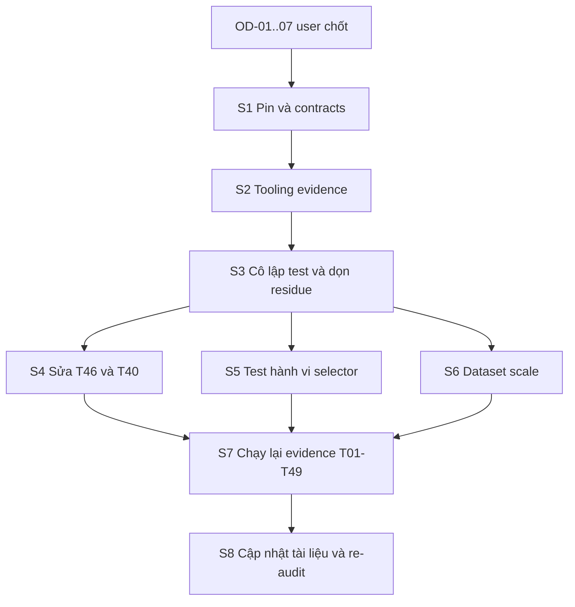

# REMEDIATION PLAN (đề xuất, chưa thực hiện)

- Dựa trên `FINAL-AUDIT.md`, git `1759717`.
- **Chưa bắt đầu bước nào.** Cả 7 OD đã được user chốt (xem `OPEN-DECISIONS.md`). Remediation là implementation nên vẫn cần user cho phép bắt đầu, vì gate đang NOT READY và user yêu cầu không khởi động implementation khi chưa READY.
- Mỗi bước dùng đúng workflow AGENTS: một commit cho mỗi bước, không push, không `--no-verify`.
- Plan này đã được điều chỉnh theo lựa chọn của user:

| OD | Lựa chọn | Tác động lên plan |
|---|---|---|
| OD-01 | A | S1 re-pin sang WP 7.1.3 / WC 11.2.1; S7 chạy lại toàn bộ evidence |
| OD-02 | C | **S6 không sinh dataset 100k/1M**. Thay bằng hạ claim và ghi quy mô đo thực; bỏ R213, R214 |
| OD-03 | A | S2 giữ digest nghiêm ngặt, tách `test-runtime.mjs` khỏi `Files` T01/T02 |
| OD-04 | B | S4 chỉ gồm cleanup postmeta có guard; hoãn retention tombstone/asset/outbox/job, archival, restore instructions và R215; cần ADR mới |
| OD-05 | A | S3 backup mới, dọn residue, namespace fixture, residue gate |
| OD-06 | A | S5 Playwright |
| OD-07 | A | S8 mở seal một lần; thêm R203–R212, R216 (R213/R214 bỏ, R215 hoãn) |

## 1. Thứ tự theo dependency

## 2. Các bước

| Bước | Nội dung tối thiểu | Task / file | Finding đóng | Phụ thuộc quyết định |
|---|---|---|---|---|
| **S1** Pin và contract | Chốt version chứng nhận. Nếu chọn re-pin: cập nhật `pins.json`, `baseline-lock.json`, `matrix.json`, `wc-props-mapping.json` (kèm tái sinh props mapping cho WC 11.2.1) và `docs/01` bảng version bằng một task contract được ủy quyền, ghi ADR | T01, T03; docs 01 | F01, F13 | OD-01, OD-07 |
| **S2** Tooling evidence | (a) Runner đọc `wp core version` / version WooCommerce đang chạy thay vì hard-code. (b) Ghi receipt theo từng R/AC từ output thật (bỏ `assertion_summary` cố định); fail nếu thiếu R/AC. (c) Ghi commit chứa task, không phải HEAD trước đó. (d) Chính sách freshness theo OD-03: tách `scripts/test-runtime.mjs` khỏi `Files` của T01/T02 hoặc chuyển digest theo input thật của từng task. (e) `ReadinessGates` so version đầy đủ. (f) Bổ sung anchor cho 11 AC | T02, T42; `scripts/test-runtime.mjs`, `scripts/evidence-lib.mjs`, `ReadinessGates.php` | F01b, F03 (một phần), F04, F10 | OD-01, OD-03 |
| **S3** Cô lập test | Harness T04 cấp namespace/cohort fixture riêng, `tearDown` bắt buộc, residue gate (đếm bảng trước/sau = 0). Backup `mysqldump` trước chạy phá huỷ. Dọn residue hiện có: 258 product `AUTO-DRAFT`/rỗng, 4 job `cleanup`, key control test (xoá dữ liệu: cần OD-05) | T04; 21 file test thiếu tearDown | F09 | OD-05 |
| **S4** T46 và T40 (OD-04 = B) | (a) Bắt buộc `product_ids`/cohort tường minh, không mặc định toàn catalog. (b) Chỉ xoá postmeta khi có native row và authority đã seal. (c) Enforce rollback window (mặc định 30 ngày theo 02 §14); retention job 7d / audit 90d hoãn theo OD-04. (d) Gate restore drill theo cohort manifest, bỏ đường tắt T49 toàn cục. (e) `RollbackRunner` đọc `mirror_stopped_*` và từ chối switch khi chưa reproject. (f) ADR mới thu hẹp T46 và cập nhật 06 T46, `tasks.json` T46, 08 §9, 02 §14 | T40, T46; `RollbackRunner.php`, `RetentionCleaner.php` | F06, F07, F08, F11 | OD-04 |
| **S5** Selector | Thay assertion chuỗi bằng test hành vi cho request_sequence/stale response (Playwright, hoặc harness Node chạy `selector.js`) theo OD-06 | T27 (+T23, T24, T26); `tests/e2e/` | F05 | OD-06 |
| **S6** Scale (OD-02 = C) | Không seed dataset. Hạ claim: sửa 02 §1, 07 §2/§6/§7 (G09 ghi "chưa đạt"), 06 và `tasks.json` T38/T47, PROGRESS title T38/T47, `docs/NOTES.md` T47 (bỏ "realistic scale"); evidence T47 ghi rõ quy mô đo thực (372 product, 1,213 catalog rows). `getScaleManifest()` giữ như định nghĩa mục tiêu tương lai | T38, T47; docs | F02 | OD-02 |
| **S7** Chạy lại evidence | Chạy `npm run test:task` cho T01…T49 theo thứ tự topological ở commit freeze, rồi `verify-task` cả 49 | tất cả | F03 | S1–S6 |
| **S8** Tài liệu và re-audit | Cập nhật `PROGRESS.md` §1, `07` §2, `independent-review.md` §3, trạng thái `regression-requirements.json` (theo OD-07), ghi QUESTIONS/NOTES. Chạy lại `check-docs`, `plan check`, `guard`, rồi một vòng audit độc lập | docs, contracts | F12, B-AUD-1/2 | OD-07 |

Ước lượng thứ tự công việc, không ước lượng thời gian. S1 đến S3 là đường găng; S4, S5, S6 có thể làm song song sau S3.

## 3. Điều kiện đóng từng bước
- S1: `pins.json` khớp `wp core version` và version WooCommerce đang chạy của host đã chốt; `check-docs --strict` pass.
- S2: test mới R203, R204, R205 pass; chạy lại một task mẫu cho thấy `environment` khớp runtime.
- S3: lệnh residue báo 0 dòng thừa; chạy hai lần liên tiếp một test không tăng số dòng.
- S4: test R206–R211 pass qua đường rollback thật.
- S5: test R212 chạy trên trình duyệt hoặc harness thật, fail khi sửa tay `selector.js` bỏ kiểm tra sequence.
- S6: không còn câu nào trong docs hay evidence tuyên bố đã đo ở 100k/1M; G09 được ghi "chưa đạt"; evidence T47 ghi số dòng thực.
- S7: `verify-task` exit 0 cho 49 task.
- S8: `READINESS-GATE.md` được đánh giá lại với mọi tiêu chí.

## 4. Regression test cần thêm (đề xuất ID, chưa tồn tại trong contract)

| ID đề xuất | Tên | Mục đích | Task |
|---|---|---|---|
| R203 | evidence_env_matches_runtime | Receipt `environment` bằng runtime thật; lệch thì fail | T02 |
| R204 | evidence_commit_binds_task | `commit` trỏ tới commit chứa file của task | T02 |
| R205 | per_requirement_receipt | Receipt R/AC lấy từ output; thiếu một R/AC thì fail | T02 |
| R206 | version_change_marks_gate_stale | WP 7.0→7.1.3 và WC 11.1.2→11.2.1 làm gate stale | T42 |
| R207 | cleanup_requires_explicit_scope | `product_ids` rỗng bị từ chối | T46 |
| R208 | cleanup_requires_native_row | Không xoá postmeta khi thiếu native row hoặc authority chưa seal | T46 |
| R209 | cleanup_requires_rollback_window | Cleanup trước hết hạn rollback window bị chặn | T46 |
| R210 | restore_gate_is_per_cohort | Gate T49 toàn cục không đủ để cleanup cohort khác | T46 |
| R211 | rollback_blocked_when_mirror_stopped | `RollbackRunner` từ chối switch khi chưa reproject | T40, T46 |
| R212 | selector_stale_response_behavioral | Phản hồi cũ đến muộn không đổi variation hiện tại (test hành vi thật) | T27 |
| ~~R213~~ | ~~scale_100k_plan~~ | Bỏ theo OD-02 = C | — |
| ~~R214~~ | ~~scale_1M_stress~~ | Bỏ theo OD-02 = C | — |
| ~~R215~~ | ~~retention_defaults_enforced~~ | Hoãn theo OD-04 = B | — |
| R216 | test_residue_zero | Sau suite, số dòng bảng test bằng trước suite | T04 |

AC bổ sung: anchor cho 11 AC hiện thiếu (AC-T01-01, AC-T02-01/02/03, AC-T03-01/02, AC-T04-01, AC-T05-01/02/03, AC-T09-01); sửa AC-T46-02 để kiểm `onActivate`/`onDeactivate` thật.

## 5. Rủi ro của remediation
- Re-pin lên WP 7.1.3 / WC 11.2.1 có thể làm lộ lỗi chức năng chưa từng bị phát hiện. Cần coi kết quả chạy lại là thông tin mới, không kỳ vọng pass.
- Dọn residue và chạy lại test phá huỷ phải có backup trước, nếu không có thể mất dữ liệu dev đang dùng.
- Sửa contract sau seal cần ADR để tránh lặp lại F03.
